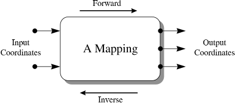
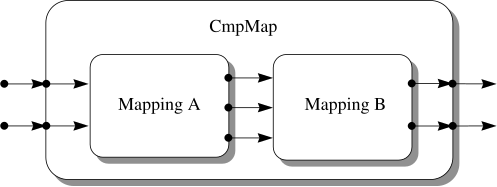
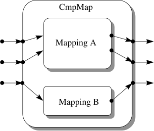
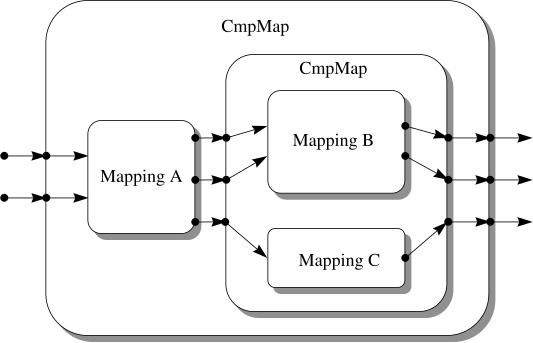
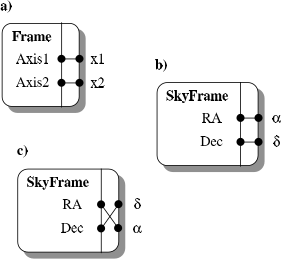
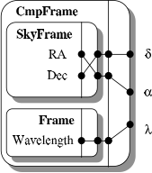
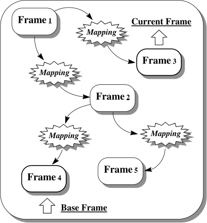

# Overview of AST Concepts

This section presents a brief overview of AST concepts.
It is intended as a basic orientation course before you move on to the more technical considerations in subsequent sections.

## Relationships Between Coordinate Systems

The relationships between coordinate systems are represented in AST by Objects called Mappings.
A Mapping does not represent a coordinate system itself, but merely the process by which you move from one coordinate system to another related one.

A convenient picture of a Mapping is as a "black box" (Figure 1) into which you can feed sets of coordinates.

*Figure 1: A Mapping viewed as a "black box" for transforming coordinates.*

For each set you feed in, the Mapping returns a corresponding set of transformed coordinates.
Since each set of coordinates represents a point in a coordinate space, the Mapping acts to inter-relate corresponding positions in the two spaces, although what these spaces represent is unspecified.
Notice that a Mapping need not have the same number of input and output coordinates.
That is, the two coordinate spaces which it inter-relates need not have the same number of dimensions.

In many cases, the transformation can, in principle, be performed in either direction: either from the *input* coordinate space to the *output*, or *vice versa*.
The first of these is termed the *forward* transformation and the other the *inverse* transformation.

**Further reading:** For a more complete discussion of Mappings, see [Inter-Relating Coordinate Systems](crate::guide::mappings) and the [`Mapping`](crate::mappings::Mapping) trait.

## Mappings Available

The basic concept of a Mapping is rather generic and obviously it is necessary to have specific Mappings that implement specific relationships between coordinate systems.
AST provides a range of these, to perform transformations such as the following and, where appropriate, their inverses:

- Conversions between various celestial coordinate systems (the [`SlaMap`](crate::mappings::SlaMap)).
- Conversions between various spectral coordinate systems (the [`SpecMap`](crate::mappings::SpecMap) and [`GrismMap`](crate::mappings::GrismMap)).
- Conversions between various time systems (the [`TimeMap`](crate::mappings::TimeMap)).
- Conversion between 2-dimensional spherical celestial coordinates (longitude and latitude) and a 3-dimensional vectorial positions (the [`SphMap`](crate::mappings::SphMap)).
- Various projections of the celestial sphere on to 2-dimensional coordinate spaces — *i.e.* map projections (the [`DssMap`](crate::mappings::DssMap) and [`WcsMap`](crate::mappings::WcsMap)).
- Permutation, introduction and elimination of coordinates (the [`PermMap`](crate::mappings::PermMap)).
- Various linear coordinate transformations (the [`MatrixMap`](crate::mappings::MatrixMap), [`WinMap`](crate::mappings::WinMap), [`ShiftMap`](crate::mappings::ShiftMap) and [`ZoomMap`](crate::mappings::ZoomMap)).
- General N-dimensional polynomial transformations (the [`PolyMap`](crate::mappings::PolyMap) and [`ChebyMap`](crate::mappings::ChebyMap)).
- Lookup tables (the [`LutMap`](crate::mappings::LutMap)).
- General-purpose transformations expressed using arithmetic operations and functions (the [`MathMap`](crate::mappings::MathMap)).
- Transformations for internal use within a program, based on private transformation functions which you write yourself in Rust (the [`IntraMap`](crate::mappings::IntraMap)).

**Further reading:** For a more complete description of each of the Mappings mentioned above, see its own documentation.
In addition, see the discussion of the PermMap and the UnitMap in [Inter-Relating Coordinate Systems](crate::guide::mappings) and the IntraMap in *Creating Your Own Private Mappings*<!-- link: crate::guide::intramaps -->.
The ZoomMap is used as an example throughout [An AST Object Primer](crate::guide::objects).

## Compound Mappings

The Mappings described above provide a set of basic building blocks from which more complex Mappings may be constructed.
The key to doing this is a type of Mapping called a [`CmpMap`](crate::mappings::CmpMap), or compound Mapping.
A CmpMap's role is, in principle, very simple: it allows any other pair of Mappings to be joined together into a single entity which behaves as if it were a single Mapping.
A CmpMap is therefore a container for another pair of Mappings.

A pair of Mappings may be combined using a CmpMap in either of two ways.
The first of these, *in series*, is illustrated in Figure 2.

*Figure 2: A CmpMap (compound Mapping) composed of two component Mappings joined in series.
The output coordinates of the first Mapping feed into the input coordinates of the second one, so that the whole entity behaves like a single Mapping.*

Here, the transformations implemented by each component Mapping are performed one after the other, with the output from the first Mapping feeding into the second.
The second way, *in parallel*, is shown in Figure 3.

*Figure 3: A CmpMap composed of two Mappings joined in parallel.
Each component Mapping acts on a complementary subset of the input and output coordinates.*

In this case, each Mapping acts on a complementary subset of the input and output coordinates.
A pair of Mappings can be combined in a third way using a [`TranMap`](crate::mappings::TranMap).
A TranMap allows the forward transformation of one Mapping to be combined with the inverse transformation of another to produce a single Mapping.

The CmpMap forms the key to building arbitrarily complex Mappings because it is itself a form of Mapping.
This means that a CmpMap may contain other CmpMaps as components (*e.g.* Figure 4).
This nesting of CmpMaps can be repeated indefinitely, so that complex Mappings may be built in a hierarchical manner out of simpler ones.

*Figure 4: CmpMaps (compound Mappings) may be nested in order to construct complex Mappings out of simpler building blocks.*

This gives AST great flexibility in the coordinate transformations it can describe.

**Further reading:** For a more complete description of CmpMaps, see [Compound Mappings](crate::guide::cmpmaps).

## Representing Coordinate Systems

While Mappings represent the relationships between coordinate systems in AST, the coordinate systems themselves are represented by Objects called Frames (Figure 5).

*Figure 5: (a) A basic Frame is used to represent a Cartesian coordinate system, here 2-dimensional.
(b) A SkyFrame represents a (spherical) celestial coordinate system.
(c) The axis order of any Frame may be permuted to match the coordinate space it describes.*

A Frame is similar in concept to the frame you might draw around a graph.
It contains information about the labels which appear on the axes, the axis units, a title, knowledge of how to format the coordinate values on each axis, *etc.*
An AST Frame is not, however, restricted to two dimensions and may have any number of axes.

A basic Frame ([`BasicFrame`](crate::frames::BasicFrame)) may be used to represent a Cartesian coordinate system by setting values for its *attributes* (all AST Objects have values associated with them called attributes, which may be set and inquired).
Usually, this would involve setting appropriate axis labels and units, for example.
Methods are provided for use with Frames to perform operations such as formatting coordinate values as text, calculating distances between points, interchanging axes, *etc.*

There are several more specialized forms of Frame, which provide the additional functionality required when handling coordinates within some specific physical domain.
This ranges from tasks such as formatting axis values, to complex tasks such as determining the transformation between any pair of related coordinate systems.
For instance, the [`SkyFrame`](crate::frames::SkyFrame) (Figure 5b,c), represents celestial coordinate systems, the [`SpecFrame`](crate::frames::SpecFrame) represents spectral coordinate systems, and the [`TimeFrame`](crate::frames::TimeFrame) represents time coordinate systems.
All these provide a wide range of different systems for describing positions within their associated physical domain, and these may be selected by setting appropriate attributes.

As with compound Mappings, it is possible to merge two Frames together to form a compound Frame, or [`CmpFrame`](crate::frames::CmpFrame), in which both sets of axes are combined.
One could, for example, have celestial coordinates on two axes and an unrelated coordinate (wavelength, perhaps) on a third (Figure 6).
Knowledge of the relationships between the axes is preserved internally by the process of constructing the CmpFrame which represents them.

*Figure 6: A CmpFrame (compound Frame) formed by combining two simpler Frames.
Note how the special relationship which exists between the RA and Dec axes is preserved within this data structure.
As with compound Mappings (Figure 4), CmpFrames may be nested in order to build more complex Frames.*

**Further reading:** For a more complete description of Frames see [Representing Coordinate Systems](crate::guide::frames), for SkyFrames see [Celestial Coordinate Systems](crate::guide::skyframes) and for SpecFrames see [Spectral Coordinate Systems](crate::guide::specframes).

## Networks of Coordinate Systems

Mappings and Frames may be connected together to form networks called FrameSets, which are used to represent sets of inter-related coordinate systems (Figure 7).

*Figure 7: A FrameSet is a network of Frames inter-connected by Mappings such that there is exactly one conversion path, via Mappings, between any pair of Frames.*

A [`FrameSet`](crate::frames::FrameSet) may be extended by adding a new Frame to it, together with an associated Mapping which relates the new coordinate system to one which is already present.
This process ensures that there is always exactly one path, *via* Mappings, between any pair of Frames.
A method is provided for identifying this path and returning the complete Mapping.

One of the Frames in a FrameSet is termed its *base* Frame.
This underlies the FrameSet's purpose, which is to calibrate datasets and other entities by attaching coordinate systems to them.
In this context, the base Frame represents the "native" coordinate system (for example, the pixel coordinates of an image).
Similarly, one Frame is termed the *current* Frame and represents the "currently-selected" coordinates.
It might, typically, be a celestial or spectral coordinate system and would be used during interactions with a user, as when plotting axes on a graph or producing a table of results.
Other Frames within the FrameSet represent a library of alternative coordinate systems which a software user can select by making them current.

**Further reading:** For a more complete description of FrameSets, see [Coordinate System Networks](crate::guide::framesets) and [Higher Level Operations on FrameSets](crate::guide::frameset_ops).

## Input/Output Facilities

AST allows you to convert any kind of Object into a stream of text which contains a full description of that Object.
This text may be written out by one program and read back in by another, thus allowing the original Object to be reconstructed.

The filter which converts Objects into text and back again is itself a kind of Object, called a [`Channel`](crate::Channel).
A Channel provides a number of options for controlling the information content of the text, such as the addition of comments for human interpretation.
It is also possible to intercept the text being processed by a Channel so that it may be redirected to/from any chosen external data store, such as a text file, an astronomical dataset, or a network connection.

The text format used by the basic Channel class is peculiar to the AST library — no other software will understand it.
However, more specialized forms of Channel are provided which use text formats more widely understood.

To further facilitate the storage of coordinate system information in astronomical datasets, a more specialized form of Channel called a [`FitsChan`](crate::FitsChan) is provided.
Instead of using free-format text, a FitsChan converts AST Objects to and from FITS header cards.
It also allows the information to be encoded in the FITS cards in a number of ways (called *encodings*), so that WCS information from a variety of sources can be handled.

**Further reading:** For a more complete description of Channels see [Saving and Restoring Objects](crate::guide::channels) and for FitsChans see [Storing AST Objects in FITS Headers](crate::guide::fitschans) and *Using Foreign FITS Encodings*<!-- link: crate::guide::foreign_fits -->.
Also see the [`Encoding`](crate::Encoding) type.
