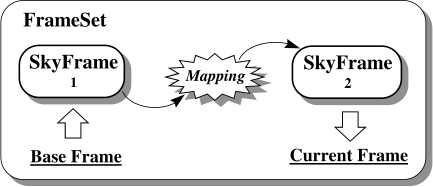
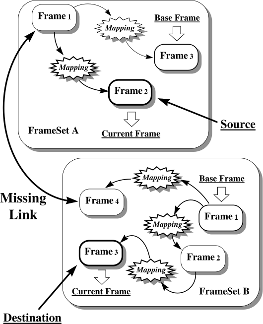
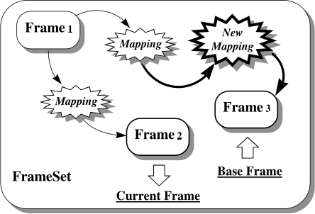
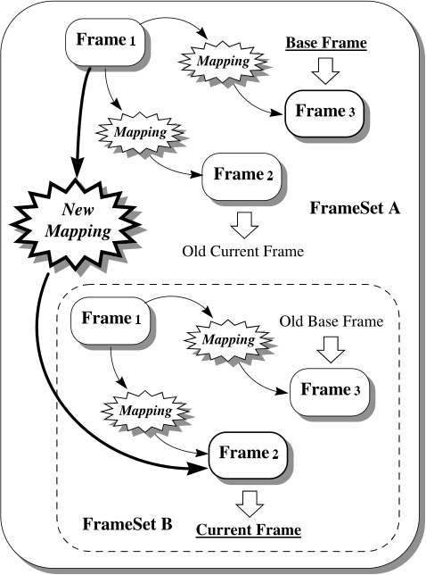

# Higher Level Operations on FrameSets

## Creating FrameSets by Conversion

Before considering the important subject of using FrameSets to convert between coordinate systems ([Converting between FrameSet Coordinate Systems](#converting-between-frameset-coordinate-systems)), let us return briefly to reconsider the output generated by [`convert_to`](crate::frames::FrameSearch::convert_to).
We used this method earlier ([An Introduction to Coordinate System Conversions](crate::guide::conversions)), when converting between the coordinate systems represented by various kinds of Frame, and indicated that it returns a FrameSet to represent the coordinate conversion it identifies.
We are now in a position to examine the structure of this FrameSet.

Take our earlier example ([Converting between Celestial Coordinate Systems](crate::guide::conversions#converting-between-celestial-coordinate-systems)) of converting between the celestial coordinate systems represented by two SkyFrames:

```rust
use ast_core::frames::{FrameSearch, SkyFrame, SkySystem};

let mut skyframe1 = SkyFrame::new(SkySystem::Fk4NoE);
skyframe1.set_epoch_year(1958.0);
skyframe1.set_equinox_year(1960.0);
let mut skyframe2 = SkyFrame::new(SkySystem::Ecliptic);
skyframe2.set_equinox_year(2010.5);

let cvt = skyframe1.convert_to(&mut skyframe2, &[])?.expect("conversion exists");
# Ok::<(), ast_core::error::AstError>(())
```

This will produce the FrameSet, `cvt`, shown in Figure 13.



*Figure 13: The FrameSet produced when `convert_to` is used to convert between the coordinate systems represented by two SkyFrames.
The source SkyFrame becomes the base Frame, while the destination SkyFrame becomes the current Frame.
The Mapping between them implements the required conversion.*

As can be seen, this FrameSet contains just two Frames.
The source Frame given to `convert_to` becomes its base Frame, while the destination Frame becomes its current Frame.
(The FrameSet holds its own copies of these Frames.)
The Mapping which relates the base Frame to the current Frame is the one which implements the required conversion.

As we noted earlier ([Converting between Celestial Coordinate Systems](crate::guide::conversions#converting-between-celestial-coordinate-systems)), the FrameSet returned by `convert_to` may be used both as a Mapping and as a Frame to perform most of the functions you are likely to need.
However, the Mapping may be extracted for use on its own if necessary, using [`mapping`](crate::frames::FrameSet::mapping) ([Extracting a Mapping from a FrameSet](crate::guide::framesets#extracting-a-mapping-from-a-frameset)), for example:

```rust
use ast_core::frames::FrameRef;
# use ast_core::frames::{FrameSearch, SkyFrame, SkySystem};
# let mut skyframe1 = SkyFrame::new(SkySystem::Fk4NoE);
# let mut skyframe2 = SkyFrame::new(SkySystem::Ecliptic);
# let cvt = skyframe1.convert_to(&mut skyframe2, &[])?.unwrap();

let mapping = cvt.mapping(FrameRef::Base, FrameRef::Current)?;
# Ok::<(), ast_core::error::AstError>(())
```

## Converting between FrameSet Coordinate Systems

We now consider the process of converting between the coordinate systems represented by two FrameSets.
This is a most important operation, as a subsequent example ([Example — Registering Two Images](#example--registering-two-images)) will show, and is illustrated in Figure 14.



*Figure 14: Conversion between two FrameSets is performed by establishing a link between a pair of Frames, one from each FrameSet.
If conversion between these two Frames is possible, then a route for converting between the current Frames of both FrameSets can also be found.
In practice, there may be many ways of pairing Frames to find the "missing link", so the Frames' Domain attribute may be used to narrow the choice.*

Recalling ([Using a FrameSet as a Frame](crate::guide::framesets#using-a-frameset-as-a-frame)) that a FrameSet will behave like its current Frame when necessary, conversion between two FrameSets is performed using `convert_to` ([Converting between Celestial Coordinate Systems](crate::guide::conversions#converting-between-celestial-coordinate-systems)), but with FrameSets instead of Frames.
The effect of this is to convert between the coordinate systems represented by the current Frames of each FrameSet:

```rust
# use ast_core::frames::{BasicFrameBuilder, FrameRef, FrameSearch, FrameSet, SkyFrame, SkySystem};
# use ast_core::mappings::ZoomMap;
# let image = || -> ast_core::error::AstResult<FrameSet> {
#     let mut fs = FrameSet::new(Box::new(BasicFrameBuilder::new(2).domain("GRID").build()?));
#     fs.add_frame(FrameRef::Base, Box::new(ZoomMap::new(2, 1e-5)?), Box::new(SkyFrame::new(SkySystem::Fk5)))?;
#     Ok(fs)
# };
# let (mut frameseta, mut framesetb) = (image()?, image()?);
let cvt = frameseta.convert_to(&mut framesetb, &["SKY"])?;
# assert!(cvt.is_some());
# Ok::<(), ast_core::error::AstError>(())
```

When using FrameSets, we are presented with considerably more conversion options than when using Frames alone.
This is because each current Frame is related to all the other Frames in its respective FrameSet.
Therefore, if we can establish a link between any pair of Frames, one from each FrameSet, we can form a complete conversion path between the two current Frames (Figure 14).

This expanded range of options is, of course, precisely the intention.
By connecting Frames together within a FrameSet, we have extended the range of coordinate systems that can be reached from any one of them.
We are therefore no longer restricted to converting between Frames with the same Domain value ([The Domain Attribute](crate::guide::frames#the-domain-attribute)), but can go *via* a range of intermediate coordinate systems in order to make the connection we require.
Transformation between different domains has therefore become possible because, in assembling the FrameSets, we provided the additional information needed to inter-relate them.

It is important to appreciate, however, that the choice of "missing link" is crucial in determining the conversion that results.
Although each FrameSet may be perfectly self-consistent internally, this does not mean that all conversion paths through the combined network of Mappings are equivalent.
Quite the contrary in fact: everything depends on where the inter-connecting link between the two FrameSets is made.
In practice, there may be a large number of possible pairings of Frames and hence of possible links.
Other factors must therefore be used to restrict the choice.
These are:

1. Not every possible pairing of Frames is legitimate.
   For example, you cannot convert directly between a basic Frame and a SkyFrame which belong to different classes, so such pairings will be ignored.
2. In a similar way, you cannot convert directly between Frames with different Domain values ([The Domain Attribute](crate::guide::frames#the-domain-attribute)).
   If the Domain attribute is used consistently (typically only one Frame in each FrameSet will have a particular Domain value), then this further restricts the choice.
3. The second argument of `convert_to` may then be used to specify explicitly which Domain value the paired Frames should have.
   You may also supply a list of preferences here (see below).
4. If the above steps fail to uniquely identify the link, then the first suitable pairing of Frames is used, so that any ambiguity is resolved by the order in which Frames are considered for pairing (see the description of [`convert_to`](crate::frames::FrameSearch::convert_to) for details of the search order).
   (If you find that how this ambiguity is resolved actually makes a difference to the conversion that results, then you have probably constructed a FrameSet which lacks internal self-consistency.
   For example, you might have two Frames representing indistinguishable coordinate systems but inter-related by a non-null Mapping.)

In the example above we supplied `["SKY"]` as the second argument of `convert_to`.
This constitutes a request that a pair of Frames with the Domain value SKY (*i.e.* representing celestial coordinate systems) should be used to inter-relate the two FrameSets.
Note that this does not specify which celestial coordinate system to use, but is a general request that the two FrameSets be inter-related using coordinates on the celestial sphere.

Of course, it may be that this request cannot be met because there may not be a celestial coordinate system in both FrameSets.
If this is likely to happen, we can supply a list of preferences, or a *domain search path*, as the second argument of `convert_to`, such as the following:

```rust
# use ast_core::frames::{BasicFrameBuilder, FrameSearch, FrameSet};
# let mut frameseta = FrameSet::new(Box::new(BasicFrameBuilder::new(2).domain("GRID").build()?));
# let mut framesetb = FrameSet::new(Box::new(BasicFrameBuilder::new(2).domain("GRID").build()?));
let cvt = frameseta.convert_to(&mut framesetb, &["SKY", "PIXEL", "GRID", ""])?;
# assert!(cvt.is_some());
# Ok::<(), ast_core::error::AstError>(())
```

Now, if the two FrameSets cannot be inter-related using the SKY domain, `convert_to` will attempt to use the PIXEL domain instead.
If this also fails, it will try the GRID domain.
An empty entry in the domain search path (here the final one) allows any Domain value to be used.
This can be employed as a last resort when all else has failed.

If `convert_to` succeeds in identifying a conversion, it will return a FrameSet ([Creating FrameSets by Conversion](#creating-framesets-by-conversion)) in which the source and destination Frames are inter-connected by the required Mapping.
In this case, of course, these Frames will be the current Frames of the two FrameSets, but in all other respects the returned FrameSet is the same as when converting between Frames.

Very importantly, however, `convert_to` may modify the FrameSets you are converting between.
It does this, in order to indicate which pairing of Frames was used to inter-relate them, by changing the Base attribute for each FrameSet so that the Frame used in the pairing becomes its base Frame ([The Base and Current Frames](crate::guide::framesets#the-base-and-current-frames)).
This is why it takes both FrameSets as `&mut`.

Finally, note that `convert_to` may also be used to convert between a FrameSet and a Frame, or *vice versa*.
If a Frame is given as either the source or the destination, it will behave like a FrameSet containing only a single Frame.

## Example — Registering Two Images

Consider two images which have been calibrated by attaching FrameSets to them, such that the base Frame of each FrameSet corresponds to the raw data grid coordinates of each image (the GRID domain of [Conventions for Domain Names](crate::guide::frames#conventions-for-domain-names)).
Suppose, also, that these FrameSets contain an unknown number of other Frames, representing alternative world coordinate systems.
What we wish to do is register these two images, such that we can transform from a position in the data grid of one into the corresponding position in the data grid of the other.
This is a very practical example because images will typically be calibrated using FrameSets in precisely this way.

The first step will probably involve making a copy of both FrameSets (using `clone` — [Copying Objects](crate::guide::objects#copying-objects)), since we will be modifying them.
Let `frameseta` and `framesetb` be these copies.
Since we want to convert between the base Frames of these FrameSets (*i.e.* their data grid coordinates), the next step is to make these Frames current.
This is simply done by inverting both FrameSets, which interchanges their base and current Frames.
[`invert`](crate::mappings::Mapping::invert) will perform this task:

```rust
use ast_core::mappings::Mapping;
# use ast_core::frames::{BasicFrameBuilder, FrameSet};
# let mut frameseta = FrameSet::new(Box::new(BasicFrameBuilder::new(2).build()?));
# let mut framesetb = FrameSet::new(Box::new(BasicFrameBuilder::new(2).build()?));

frameseta.invert();
framesetb.invert();
# Ok::<(), ast_core::error::AstError>(())
```

To identify the required conversion, we now use `convert_to`, supplying a suitable domain search path with which we would like our two images to be registered:

```rust
use ast_core::frames::{Frame, FrameSearch};
use ast_core::mappings::Mapping;
# use ast_core::frames::{BasicFrameBuilder, FrameRef, FrameSet, SkyFrame, SkySystem};
# use ast_core::mappings::{ShiftMap, ZoomMap};
# // Two images whose PIXEL coordinates are offset from GRID by 10 and 20,
# // with the same celestial calibration in PIXEL coordinates.
# let image = |shift: f64| -> ast_core::error::AstResult<FrameSet> {
#     let mut fs = FrameSet::new(Box::new(BasicFrameBuilder::new(2).domain("GRID").build()?));
#     fs.add_frame(FrameRef::Base, Box::new(ShiftMap::new([shift, shift])), Box::new(BasicFrameBuilder::new(2).domain("PIXEL").build()?))?;
#     fs.add_frame(FrameRef::Index(2), Box::new(ZoomMap::new(2, 1e-5)?), Box::new(SkyFrame::new(SkySystem::Fk5)))?;
#     Ok(fs)
# };
# let (mut frameseta, mut framesetb) = (image(10.0)?, image(20.0)?);
# frameseta.invert();
# framesetb.invert();

match frameseta.convert_to(&mut framesetb, &["SKY", "PIXEL", "GRID"])? {
    None => {
        // <no conversion was possible>
#       unreachable!();
    }
    Some(cvt) => {
        // <conversion was possible>
#       let (x, y) = cvt.tran2(&[1.0], &[1.0], true)?;
#       assert!((x[0] + 9.0).abs() < 1e-9 && (y[0] + 9.0).abs() < 1e-9);
    }
}
# Ok::<(), ast_core::error::AstError>(())
```

The effects of this are:

1. `convert_to` first attempts to register the two images on the celestial sphere (*i.e.* using the SKY domain).
   To do this, it searches for a celestial coordinate system, although not necessarily the same one, attached to each image.
   If it finds a suitable pair of coordinate systems, it then registers the images by matching corresponding positions on the sky.
2. If this fails, `convert_to` next tries to match positions in the PIXEL domain ([The Domain Attribute](crate::guide::frames#the-domain-attribute)).
   If it succeeds, the two images will then be registered so that their corresponding pixel positions correspond.
   If the PIXEL domain is offset from the data grid (as typically happens in data reduction systems which implement a "pixel origin"), then this will be correctly accounted for.
3. If this also fails, the GRID domain is finally used.
   This will result in image registration by matching corresponding points in the data grids used by both images.
   This means they will be aligned so that the first elements of their data arrays correspond.
4. If all of the above fail, `convert_to` will return `None`.
   Otherwise a FrameSet will be returned.

The resulting `cvt` FrameSet may then be used directly ([Converting between Celestial Coordinate Systems](crate::guide::conversions#converting-between-celestial-coordinate-systems)) to convert between positions in the data grid of the first image and corresponding positions in the data grid of the second image.

To determine which domain was used to achieve registration, we can use the fact that the Base attribute of each FrameSet is set by `convert_to` to indicate which intermediate Frames were used.
We can therefore simply invert either FrameSet (to make its base Frame become the current one) and then inquire the Domain value:

```rust
# use ast_core::frames::{BasicFrameBuilder, Frame, FrameRef, FrameSearch, FrameSet, SkyFrame, SkySystem};
# use ast_core::mappings::{Mapping, ShiftMap, ZoomMap};
# let image = |shift: f64| -> ast_core::error::AstResult<FrameSet> {
#     let mut fs = FrameSet::new(Box::new(BasicFrameBuilder::new(2).domain("GRID").build()?));
#     fs.add_frame(FrameRef::Base, Box::new(ShiftMap::new([shift, shift])), Box::new(BasicFrameBuilder::new(2).domain("PIXEL").build()?))?;
#     fs.add_frame(FrameRef::Index(2), Box::new(ZoomMap::new(2, 1e-5)?), Box::new(SkyFrame::new(SkySystem::Fk5)))?;
#     Ok(fs)
# };
# let (mut frameseta, mut framesetb) = (image(10.0)?, image(20.0)?);
# frameseta.invert();
# framesetb.invert();
# frameseta.convert_to(&mut framesetb, &["SKY", "PIXEL", "GRID"])?;
frameseta.invert();
let domain = frameseta.domain();
# assert_eq!(domain, "SKY");
# Ok::<(), ast_core::error::AstError>(())
```

If conversion was successful, the result will be one of the strings "SKY", "PIXEL" or "GRID".

## Re-Defining a FrameSet Coordinate System

As discussed earlier ([The Base and Current Frames](crate::guide::framesets#the-base-and-current-frames)), an important application of a FrameSet is to allow coordinate system information to be attached to entities such as images in order to calibrate them.
In addition, one of the main objectives of AST is to simplify the propagation of such information through successive stages of data processing, so that it remains consistent with the associated image data.

In such a situation, the FrameSet's base Frame would correspond with the image's data grid coordinates and its other Frames (if any) with the various alternative world coordinate systems associated with the image.
If the data processing being performed does not change the relationship between the image's data grid coordinates and any of the associated world coordinate systems, then propagation of the WCS information is straightforward and simply involves copying the FrameSet associated with the image.

If any of these relationships change, however, then corresponding changes must be made to the way Frames within the FrameSet are inter-related.
By far the most common case occurs when the image undergoes some geometrical transformation resulting in "re-gridding" on to another data grid, but the same principles can be applied to any re-definition of a coordinate system.

To pursue the re-gridding example, we would need to modify our FrameSet to account for the fact that the image's data grid coordinate system (corresponding to the FrameSet's base Frame) has changed.
Looking at the steps needed in detail, we might proceed as follows:

1. Create a Mapping which represents the relationship between the original data grid coordinate system and the new one.
2. Obtain a Frame to represent the new data grid coordinate system (we could re-use a copy of the original base Frame here).
3. Add the new Frame to the FrameSet, related to the original base Frame by the new Mapping.
   This Frame now represents the new data grid coordinate system and is correctly related to all the other Frames present (because any transformation to or from this new Frame must go *via* the base Frame representing the original data grid coordinate system, which we assume was correctly related to all the other Frames present).
4. Remove the original base Frame (representing the old data grid coordinate system).
5. Make the new Frame the base Frame and restore the original current Frame.

The effect of these steps is to change the relationship between the base Frame and all the other Frames present.
It is as if a new Mapping has been interposed between the Frame we want to alter and all the other Frames within the FrameSet (Figure 15).



*Figure 15: The effect of `remap_frame` is to interpose a Mapping between a nominated Frame within a FrameSet and the remaining contents of the FrameSet.
This effectively "re-defines" the coordinate system represented by the affected Frame.
It may be used to compensate (say) for geometrical changes made to an associated image.
The inter-relationships between all the other Frames within the FrameSet remain unchanged.*

Performing the steps above is rather lengthy, however, so [`remap_frame`](crate::frames::FrameSet::remap_frame) is provided to perform all of these operations in one go.
A practical example of its use is given below ([Example — Binning an Image](#example--binning-an-image)).

## Example — Binning an Image

As an example of using `remap_frame`, consider a case where the pixels of a 2-dimensional image have been binned 2×2, so as to reduce the image size by a factor of two in each dimension.
We must now modify the associated FrameSet to reflect this change to the image.
Much the same process would be needed for any other geometrical change the image might undergo.

We first set up a Mapping (a [`WinMap`](crate::mappings::WinMap) in this case) which relates the data grid coordinates in the original image to those in the new one:

```rust
use ast_core::mappings::WinMap;

let ina = [0.5, 0.5];
let inb = [2.5, 2.5];
let outa = [0.5, 0.5];
let outb = [1.5, 1.5];

let winmap = WinMap::from_corners(&ina, &inb, &outa, &outb)?;
# Ok::<(), ast_core::error::AstError>(())
```

Here, we have simply set up arrays containing the data grid coordinates of the bottom left and top right corners of the first element in the output image (`outa` and `outb`) and the corresponding coordinates in the input image (`ina` and `inb`).
[`WinMap::from_corners`](crate::mappings::WinMap::from_corners) then creates a WinMap which performs the required transformation.
We do not need to know the size of the image.

We can then pass this WinMap to `remap_frame`.
This modifies the relationship between our FrameSet's base Frame and the other Frames in the FrameSet, so that the base Frame represents the data grid coordinate system of the new image rather than the old one:

```rust
use ast_core::frames::FrameRef;
# use ast_core::frames::{BasicFrameBuilder, FrameSet, SkyFrame, SkySystem};
# use ast_core::mappings::{Mapping, WinMap, ZoomMap};
# let mut frameset = FrameSet::new(Box::new(BasicFrameBuilder::new(2).domain("GRID").build()?));
# frameset.add_frame(FrameRef::Base, Box::new(ZoomMap::new(2, 1e-5)?), Box::new(SkyFrame::new(SkySystem::Fk5)))?;
# let winmap = WinMap::from_corners(&[0.5, 0.5], &[2.5, 2.5], &[0.5, 0.5], &[1.5, 1.5])?;
# let before = frameset.tran2(&[3.0], &[3.0], true)?;

frameset.remap_frame(FrameRef::Base, Box::new(winmap))?;
# // Old pixel (3, 3) is new pixel (1.75, 1.75) and still at the same place on the sky.
# assert_eq!(frameset.tran2(&[1.75], &[1.75], true)?, before);
# Ok::<(), ast_core::error::AstError>(())
```

Any other coordinate systems described by the FrameSet, no matter how many of these there might be, are now correctly associated with the new image.

## Maintaining the Integrity of FrameSets

When constructing a FrameSet, you are provided with a framework into which you can place any combination of Frames and Mappings that you wish.
There are relatively few constraints on this process and no checks are performed to see whether the FrameSet you construct makes physical sense.
It is quite possible, for example, to construct a FrameSet containing two identical SkyFrames which are inter-related by a non-unit Mapping.
AST will not object if you do this, but it makes no sense, because applying a non-unit Mapping to any set of celestial coordinates cannot yield positions that are still in the original coordinate system.
If you use such a FrameSet to perform coordinate conversions, you are likely to get unpredictable results because the information in the FrameSet is corrupt.

It is, of course, your responsibility as a programmer to ensure the validity of any information which you insert into a FrameSet.
Normally, this is straightforward and simply consists of formulating your problem correctly (a diagram can often help to clarify how coordinate systems are inter-related) and writing the appropriate bug-free code to construct the FrameSet.
However, once you start to modify an existing FrameSet, there are new opportunities for corrupting it!

Consider, for example, a FrameSet whose current Frame is a SkyFrame.
We can set a new value for this SkyFrame's Equinox attribute through the FrameSet with [`with_integrity`](crate::frames::FrameSet::with_integrity), as follows:

```rust
use ast_core::frames::SkyFrame;
# use ast_core::frames::{FrameSet, SkySystem};
# let mut frameset = FrameSet::new(Box::new(SkyFrame::new(SkySystem::Fk5)));

frameset.with_integrity(|frame| {
    let skyframe = frame.as_any_mut().downcast_mut::<SkyFrame>().expect("a SkyFrame");
    skyframe.set_equinox_year(2010.0);
    Ok(())
})?;
# Ok::<(), ast_core::error::AstError>(())
```

The effect of this will be to change the celestial coordinate system which the current Frame represents.
You can see, however, that this has the potential to make the FrameSet corrupt unless corresponding changes are also made to the Mapping which relates this SkyFrame to the other Frames within the FrameSet.
In fact, it is a general rule that any change to a FrameSet which affects its current Frame can potentially require corresponding changes to the FrameSet's Mappings in order to maintain its overall integrity.

Fortunately, once you have stored valid information in a FrameSet, AST will look after these details for you automatically, so that the FrameSet's integrity is maintained.
In the example above, it would do this by appropriately re-mapping the current Frame (as if `remap_frame` had been used — [Re-Defining a FrameSet Coordinate System](#re-defining-a-frameset-coordinate-system)).
The same happens when an attribute that every Frame has, such as the Unit of an axis, is set through the [`Frame`](crate::frames::Frame) trait on the FrameSet.
One way of illustrating this process is as follows:

```rust
use ast_core::frames::{FrameRef, FrameSet, SkyFrame};
use ast_core::mappings::UnitMap;

let skyframe = SkyFrame::unset_system();
let mut frameset = FrameSet::new(Box::new(skyframe.clone()));
frameset.add_frame(FrameRef::Index(1), Box::new(UnitMap::new(2)), Box::new(skyframe))?;
# Ok::<(), ast_core::error::AstError>(())
```

This constructs a trivial FrameSet whose base and current Frames are both the same SkyFrame connected by a UnitMap.
You can think of this as a "pipe" connecting two coordinate systems.
At present, these two systems represent identical ICRS coordinates, so the FrameSet implements a unit Mapping.
We can change the coordinate system on the current end of this pipe as follows:

```rust
# use ast_core::frames::{FrameRef, FrameSet, SkyFrame};
use ast_core::frames::SkySystem;
# use ast_core::mappings::UnitMap;
# let skyframe = SkyFrame::unset_system();
# let mut frameset = FrameSet::new(Box::new(skyframe.clone()));
# frameset.add_frame(FrameRef::Index(1), Box::new(UnitMap::new(2)), Box::new(skyframe))?;
frameset.with_integrity(|frame| {
    let skyframe = frame.as_any_mut().downcast_mut::<SkyFrame>().expect("a SkyFrame");
    skyframe.set_system(SkySystem::Ecliptic);
    skyframe.set_equinox_year(2010.0);
    Ok(())
})?;
# Ok::<(), ast_core::error::AstError>(())
```

and the Mapping which the FrameSet implements would change accordingly.
To change the coordinate system on the base end of the pipe, we might use:

```rust
use ast_core::mappings::Mapping;
# use ast_core::frames::{FrameRef, FrameSet, SkyFrame, SkySystem};
# use ast_core::mappings::UnitMap;
# let skyframe = SkyFrame::unset_system();
# let mut frameset = FrameSet::new(Box::new(skyframe.clone()));
# frameset.add_frame(FrameRef::Index(1), Box::new(UnitMap::new(2)), Box::new(skyframe))?;
# frameset.with_integrity(|frame| {
#     frame.as_any_mut().downcast_mut::<SkyFrame>().unwrap().set_system(SkySystem::Ecliptic);
#     Ok(())
# })?;
frameset.invert();
frameset.with_integrity(|frame| {
    let skyframe = frame.as_any_mut().downcast_mut::<SkyFrame>().expect("a SkyFrame");
    skyframe.set_system(SkySystem::Galactic);
    Ok(())
})?;
frameset.invert();
# let base = frameset.frame(FrameRef::Base)?.as_any().downcast_ref::<SkyFrame>().unwrap();
# assert_eq!(base.system(), SkySystem::Galactic);
# Ok::<(), ast_core::error::AstError>(())
```

The FrameSet would then convert between galactic and ecliptic coordinates.

Note that `with_integrity` is not the only way to have this effect: clearing an attribute through the FrameSet behaves similarly, as also does [`perm_axes`](crate::frames::Frame::perm_axes) ([Permuting Frame Axes](crate::guide::frames#permuting-frame-axes)).
If you need to circumvent this mechanism for any reason, this can be done by going behind the scenes with [`frame_mut`](crate::frames::FrameSet::frame_mut), which gives direct access to the Frame you wish to modify.
Consider the following, for example:

```rust
use ast_core::frames::FrameRef;
# use ast_core::frames::{FrameSet, SkyFrame, SkySystem};
# let mut frameset = FrameSet::new(Box::new(SkyFrame::new(SkySystem::Fk5)));

let skyframe = frameset
    .frame_mut(FrameRef::Current)?
    .as_any_mut()
    .downcast_mut::<SkyFrame>()
    .expect("a SkyFrame");
skyframe.set_equinox_year(2010.0);
# Ok::<(), ast_core::error::AstError>(())
```

Here, the change is made to the SkyFrame directly rather than through the FrameSet, so the usual checks on FrameSet integrity do not occur.
The SkyFrame's Equinox attribute will therefore be modified without any corresponding change to the FrameSet's Mappings.
In this case you must take responsibility yourself for maintaining the FrameSet's integrity, perhaps through appropriate use of `remap_frame`.

## Merging FrameSets

As well as adding individual Frames to a FrameSet ([Adding New Frames to a FrameSet](crate::guide::framesets#adding-new-frames-to-a-frameset)), it is also possible to add complete sets of inter-related Frames which are contained within another FrameSet.
This, of course, corresponds to the process of merging two FrameSets (Figure 16).



*Figure 16: Two FrameSets in the process of being merged.
FrameSet B is being added to FrameSet A by supplying a new Mapping which inter-relates a nominated Frame in A (here number 1) and the current Frame of B.
In the merged FrameSet, the Frames contributed by B will be re-numbered to become Frames 4, 5 and 6.
The base Frame will remain unchanged, but the current Frame of B becomes the new current Frame.
Note that FrameSet B itself is not altered by this process.*

This process is performed by adding one FrameSet to another using [`add_frameset`](crate::frames::FrameSet::add_frameset), in much the same manner as when adding a new Frame to an existing FrameSet ([Adding New Frames to a FrameSet](crate::guide::framesets#adding-new-frames-to-a-frameset)).
In performing the merger you must, as usual, supply a Mapping, but in this case the Mapping should relate the current Frame of the FrameSet being added to one of the Frames already present.
For example, you might perform the merger shown in Figure 16 as follows:

```rust
# use ast_core::frames::{BasicFrameBuilder, FrameRef, FrameSet};
# use ast_core::mappings::UnitMap;
# let three = || -> ast_core::error::AstResult<FrameSet> {
#     let mut fs = FrameSet::new(Box::new(BasicFrameBuilder::new(2).build()?));
#     fs.add_frame(FrameRef::Index(1), Box::new(UnitMap::new(2)), Box::new(BasicFrameBuilder::new(2).build()?))?;
#     fs.add_frame(FrameRef::Index(1), Box::new(UnitMap::new(2)), Box::new(BasicFrameBuilder::new(2).build()?))?;
#     Ok(fs)
# };
# let (mut frameseta, framesetb) = (three()?, three()?);
# let mapping = UnitMap::new(2);
frameseta.add_frameset(FrameRef::Index(1), Box::new(mapping), framesetb.clone())?;
# assert_eq!((frameseta.nframe(), frameseta.base_index(), frameseta.current_index()), (6, 1, 6));
# assert_eq!(framesetb.nframe(), 3);
# Ok::<(), ast_core::error::AstError>(())
```

The Frames acquired by `frameseta` from the FrameSet being added (`framesetb`) are re-numbered so that they retain their original order and follow on consecutively after the Frames that were already present, whose indices remain unchanged.
The base Frame of `frameseta` remains unchanged, but the current Frame of `framesetb` becomes its new current Frame.
All the inter-relationships between Frames in both FrameSets remain in place and are preserved in the merged FrameSet.

`add_frameset` takes ownership of the FrameSet being added; pass a copy made with `clone`, as here, to keep using the original, which is then left unchanged.
