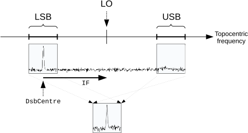
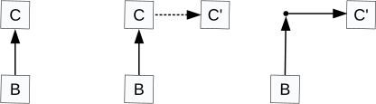
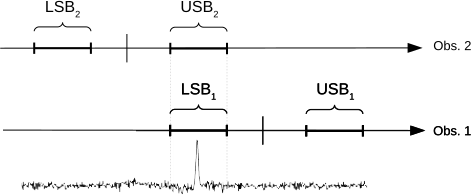

# Spectral Coordinate Systems (SpecFrames)

The [`SpecFrame`](crate::frames::SpecFrame) is a Frame which is specialized for representing coordinate systems which describe a position within an electro-magnetic spectrum.
In this section we examine the additional properties and behavior of a SpecFrame that distinguish it from a basic Frame ([Representing Coordinate Systems](crate::guide::frames)).

## The SpecFrame Model

As for a SkyFrame, a SpecFrame is a Frame ([Representing Coordinate Systems](crate::guide::frames)), so it has all the properties and behavior of a basic Frame.

A SpecFrame represents a wide range of different 1-dimensional coordinate systems which can be used to describe positions within a spectrum.
The options available largely mirror those described in the FITS-WCS paper III *Representations of spectral coordinates in FITS* (Greisen, Valdes, Calabretta & Allen).

## Creating a SpecFrame

A SpecFrame with default attributes is created as follows:

```rust
use ast_core::frames::SpecFrame;

let specframe = SpecFrame::unset_system();
```

Such a SpecFrame would represent the default coordinate system which is heliocentric wavelength in meters (i.e. wavelength corrected to take into account the Doppler shift caused by the velocity of the observer around the sun).

## Specifying a Particular Spectral Coordinate System

Selection of a particular coordinate system is performed simply by setting a value for the SpecFrame's System attribute, a [`SpecSystem`](crate::frames::SpecSystem).
This setting is most conveniently done when the SpecFrame is created.
For example, a SpecFrame representing Energy would be created by:

```rust
use ast_core::frames::{Frame, SpecFrame, SpecSystem};

let specframe = SpecFrame::new(SpecSystem::Energy);
# assert_eq!(specframe.unit(1)?, "J");
# Ok::<(), ast_core::error::AstError>(())
```

Note that specifying the Energy system also changes the associated Unit (from meters to Joules).
This is because the default value of the SpecFrame's Unit attribute depends on the System attribute setting.

You may change the System value at any time with [`set_system`](crate::frames::SpecFrame::set_system), although this is not usually needed.
The values supported are set out in the description of [`SpecSystem`](crate::frames::SpecSystem) and include a variety of velocity systems, together with frequency, wavelength, energy, wave-number, *etc*.

## Attributes which Qualify Spectral Coordinate Systems

Many spectral coordinate systems have some additional free parameters which serve to identify a particular coordinate system from amongst a broader class of related coordinate systems.
For example, the velocity systems are all parameterized by a rest frequency — the frequency which defines zero velocity, and all coordinate systems are qualified by a "standard of rest" which indicates the rest frame to which the values refer.

In AST, these free parameters are represented by additional SpecFrame attributes, each of which has a default appropriate to (*i.e.* defined by) the setting of the main System attribute.
Each of these *qualifying attributes* may, however, be assigned an explicit value so as to select a particular coordinate system.
Note, it is usually best to assign explicit values whenever possible rather than relying on defaults.
Attributes should only be left at their default value if you "don't care" what value is used.
In certain circumstances (particularly, when aligning two Frames), a default value for an attribute may be replaced by the value from another similar Frame.
Such value replacement can be prevented by assigning an explicit value to the attribute, rather than simply relying on the default.

The main SpecFrame attributes which qualify the System attribute are:

- **Epoch**:
  This attribute is shared by every Frame.
  It gives the moment in time when the coordinates are correct for the astronomical source under study (usually the date of observation).
  It is needed in order to calculate the Doppler shift produced by the velocity of the observer relative to the center of the earth, and of the earth relative to the sun.
- **StdOfRest**:
  This specifies the rest frame in which the coordinates are correct ([`std_of_rest`](crate::frames::SpecFrame::std_of_rest)).
  Transforming between different standards of rest involves taking account of the Doppler shift introduced by the relative motion of the two standards of rest.
- **RestFreq**:
  Specifies the frequency which corresponds to zero velocity ([`rest_freq`](crate::frames::SpecFrame::rest_freq)), in Hz.
- **RefRA**:
  Specifies the RA (FK5 J2000) of the source ([`ref_ra`](crate::frames::SpecFrame::ref_ra)).
  This is used when converting between standards of rest.
  It specifies the direction along which the component of the relative velocity of the two standards of rest is taken.
- **RefDec**:
  Specifies the Dec (FK5 J2000) of the source ([`ref_dec`](crate::frames::SpecFrame::ref_dec)).
  Used in conjunction with RefRA.
  Both may be set at once, from a position in any celestial coordinate system, with [`set_ref_pos`](crate::frames::SpecFrame::set_ref_pos).
- **SourceVel**:
  This defines the "source" standard of rest ([`source_vel`](crate::frames::SpecFrame::source_vel)).
  This is a rest frame which is moving towards the position given by RefRA and RefDec, at a velocity given by SourceVel.
  The velocity is stored internally as a heliocentric velocity, but can be given in any of the other supported standards of rest.

For further details of these attributes you should consult their descriptions, and for details of the System settings for which they are relevant, see the description of [`SpecSystem`](crate::frames::SpecSystem).

Note that it does no harm to assign values to qualifying attributes which are not relevant to the main System value.
Any such values are stored, but are not used unless the System value is later set so that they become relevant.

## Using Default SpecFrame Attributes

The default values supplied for many SpecFrame attributes will depend on the value of the SpecFrame's System attribute.
In practice, this means that there is usually little need to specify many of these attributes explicitly unless you have some special requirement.
This can be illustrated by using `show` to examine a SpecFrame, as follows:

```rust
use ast_core::frames::{SpecFrame, SpecSystem};

let mut specframe = SpecFrame::new(SpecSystem::Voptical);
specframe.set_rest_freq(250.0e9);
specframe.show()?;
# use ast_core::{AnyObject, Channel, NativeChannel};
# let mut shown = NativeChannel::with_string_sink();
# shown.write(&AnyObject::SpecFrame(specframe.clone()))?;
# assert_eq!(shown.into_string(), " Begin SpecFrame \t# Description of spectral coordinate system\n#   Title = \"Optical velocity, rest frequency = 250 GHz\" \t# Title of coordinate system\n    Naxes = 1 \t# Number of coordinate axes\n#   Domain = \"SPECTRUM\" \t# Coordinate system domain\n#   Epoch = 2000 \t# Julian epoch of observation\n#   Lbl1 = \"Optical velocity\" \t# Label for axis 1\n    System = \"VOPT\" \t# Coordinate system type\n#   Uni1 = \"km/s\" \t# Units for axis 1\n    Ax1 = \t# Axis number 1\n       Begin Axis \t# Coordinate axis\n       End Axis\n IsA Frame \t# Coordinate system description\n#   SoR = \"Heliocentric\" \t# Standard of rest\n    RstFrq = 250000000000 \t# Rest frequency (Hz)\n End SpecFrame\n");
# specframe.set_system(SpecSystem::Freq)?;
# let mut shown = NativeChannel::with_string_sink();
# shown.write(&AnyObject::SpecFrame(specframe))?;
# assert!(shown.into_string().contains("#   Uni1 = \"GHz\" \t# Units for axis 1\n"));
# Ok::<(), ast_core::error::AstError>(())
```

The output from this might look like the following:

```text
 Begin SpecFrame 	# Description of spectral coordinate system
#   Title = "Optical velocity, rest frequency = 250 GHz" 	# Title of coordinate system
    Naxes = 1 	# Number of coordinate axes
#   Domain = "SPECTRUM" 	# Coordinate system domain
#   Epoch = 2000 	# Julian epoch of observation
#   Lbl1 = "Optical velocity" 	# Label for axis 1
    System = "VOPT" 	# Coordinate system type
#   Uni1 = "km/s" 	# Units for axis 1
    Ax1 = 	# Axis number 1
       Begin Axis 	# Coordinate axis
       End Axis
 IsA Frame 	# Coordinate system description
#   SoR = "Heliocentric" 	# Standard of rest
    RstFrq = 250000000000 	# Rest frequency (Hz)
 End SpecFrame
```

Note that the defaults (indicated by the "#" comment character at the start of the line) for attributes such as the Title, axis Labels and Unit specifiers are all set to values appropriate for the particular velocity system that the SpecFrame represents.

These choices would be appropriate for a System value of optical velocity, but if a different System value were set, the defaults would be correspondingly different.
For example, by default frequency is measured in units of GHz, not km/s, so setting the System to [`SpecSystem::Freq`](crate::frames::SpecSystem::Freq) would change the appropriate line above from:

```text
#   Uni1 = "km/s" 	# Units for axis 1
```

to

```text
#   Uni1 = "GHz" 	# Units for axis 1
```

Of course, if you do not like any of these defaults, you may always over-ride them by setting explicit attribute values yourself.
For instance, you may choose to have your frequency axis expressed in "kHz" rather than "GHz".
To do this simply set the attribute value as follows:

```rust
use ast_core::frames::{Frame, SpecFrame, SpecSystem};

let mut specframe = SpecFrame::new(SpecSystem::Freq);
# assert_eq!(specframe.unit(1)?, "GHz");
specframe.set_unit(1, "kHz")?;
# Ok::<(), ast_core::error::AstError>(())
```

No error will be reported if you accidentally set an inappropriate Unit value (say "J" — Joules) — after all, AST cannot tell what you are about to do, and you *may* be about to change the System value to Energy.
However, an error *will* be reported if you attempt to find a conversion between two SpecFrames (for instance using [`convert_to`](crate::frames::FrameSearch::convert_to)) if either SpecFrame has a Unit value which is inappropriate for its System value.

SpecFrame attributes, like all other attributes, all have default values.
However, be aware that for some attributes these default values can never be more than "a legal numerical value" and have no astronomical significance.
For instance, the RefRA and RefDec attributes (which give the source position) both have a default value of zero.
So unless your source happens to be at that point (highly unlikely!) you will need to set new values.
Likewise, the RestFreq (rest frequency) attribute has an arbitrary default value of 1.0E5 GHz.
Some operations are not affected by inappropriate values for these attributes (for instance, converting from frequency to wavelength, changing axis units, *etc*), but some are.
For instance, converting from frequency to velocity requires a correct rest frequency, moving between different standards of rest requires a correct source position.
The moral is, always set explicit values for as many attributes as possible.

## Creating Spectral Cubes

You can use a SpecFrame to describe the spectral axis in a data cube containing two spatial axes and a spectral axis.
To do this you would create an appropriate SpecFrame, together with a 2-dimensional Frame (often a SkyFrame) to describe the spatial axes.
You would then combine these two Frames together into a single [`CmpFrame`](crate::frames::CmpFrame).

```rust
use ast_core::frames::{CmpFrame, Frame, SkyFrame, SkySystem, SpecFrame, SpecSystem, StdOfRest};

let mut skyframe = SkyFrame::unset_system();
skyframe.set_epoch_year(2002.0);
let mut specframe = SpecFrame::new(SpecSystem::Freq);
specframe.set_std_of_rest(StdOfRest::Lsrk)?;
let cmpframe = CmpFrame::new(Box::new(skyframe), Box::new(specframe));
# assert_eq!(cmpframe.naxes(), 3);
# assert_eq!(cmpframe.label(3)?, "Frequency");
# Ok::<(), ast_core::error::AstError>(())
```

In the resulting CmpFrame, axis 1 will be RA, axis 2 will be Dec and axis 3 will be Frequency.
If this is not the order you want, you can permute the axes using [`perm_axes`](crate::frames::Frame::perm_axes).

There is one potential problem with this approach if you are interested in unusually high accuracy.
Conversion between different standards of rest involves taking account of the Doppler shift caused by the relative motion of the two standards of rest.
At some point this involves finding the component of the relative velocity in the direction of interest.
For a SpecFrame, this direction is always given by the RefRA and RefDec attributes, even if the SpecFrame is embedded within a CmpFrame as above.
It would be more appropriate if this "direction of interest" was specified by the values passed into the CmpFrame on the RA and DEC axes, allowing each pixel within a data cube to have a slightly different correction for Doppler shift.

Unfortunately, the SpecFrame class cannot do this (since it is purely a 1-dimensional Frame), and so some small degree of error will be introduced when converting between standards of rest, the size of the error varying from pixel to pixel.

The maximum velocity error introduced by this problem is of the order of V\*SIN(FOV), where FOV is the angular field of view, and V is the relative velocity of the two standards of rest.
As an example, when correcting from the observer's rest frame (i.e. the topocentric rest frame) to the kinematic local standard of rest the maximum value of V is about 20 km/s, so for 5 arc-minute field of view the maximum velocity error introduced by the correction will be about 0.03 km/s.
As another example, the maximum error when correcting from the observer's rest frame to the local group is about 5 km/s over a 1 degree field of view.

## Handling Dual-Sideband Spectra

Dual sideband super-heterodyne receivers produce spectra in which each channel contains contributions from two different frequencies, referred to as the "upper sideband" (USB) frequency and the "lower sideband" (LSB) frequency.
In the rest frame of the observer (topocentric), these are related to each other as follows:

> f<sub>lsb</sub> = 2 f<sub>LO</sub> − f<sub>usb</sub>  (1)

where f<sub>LO</sub> is a fixed frequency known as the "local oscillator frequency".
In other words, the local oscillator frequency is always mid-way between any pair of corresponding upper and lower sideband frequencies (this simple relationship only applies if all frequencies are topocentric).
This is illustrated in Figure 9.
The astronomical signal received in the two spectral windows (one corresponding to each sideband) are superimposed in the final measured spectrum, with the signal from the USB window first being reversed in frequency.



*Figure 9: A dual-sideband spectrum is formed by superimposing the signal received from two spectral windows — the lower sideband (LSB) and upper sideband (USB).
In topocentric frequency, the two sidebands are equally spaced on either side of the local oscillator (LO) frequency.
In other spectral systems the width and placement of the windows may not be symmetric about the LO.*

To describe the spectral axis of the final measured spectrum using a SpecFrame you must choose whether you want the SpecFrame to describe the frequency of the LSB window (f<sub>lsb</sub>) or of the USB window (f<sub>usb</sub>) — a basic SpecFrame cannot describe both sidebands simultaneously.
However, there is a specialized kind of SpecFrame, called [`DSBSpecFrame`](crate::frames::DSBSpecFrame), which overcomes this difficulty.

A DSBSpecFrame has a SideBand attribute ([`sideband`](crate::frames::DSBSpecFrame::sideband)) which indicates if the DSBSpecFrame is currently being used to describe the upper or lower sideband spectral axis.
The value of this attribute can be changed at any time.
A DSBSpecFrame knows how to transform frequencies between the two sidebands.
For instance, if you have two DSBSpecFrame objects that describe topocentric frequency and are identical except that they describe opposite sidebands, then [`convert_to`](crate::frames::FrameSearch::convert_to) will return a Mapping that implements equation (1) (this requires the AlignSideband attribute to be set to `true` in both DSBSpecFrames).
If the DSBSpecFrames describe anything other than topocentric frequency, then the returned Mapping will be more complicated since it will include conversions to and from topocentric frequency.

In practice, the local oscillator frequency for a dual sideband instrument may not be easily available to an observer.
Instead, it is common practice to specify the spectral position of some central feature in the observation (commonly the center of the instrument passband), together with an "intermediate frequency".
Together, these two values allow the local oscillator frequency to be determined.
The intermediate frequency is the difference between the topocentric frequency at the central spectral position and the topocentric frequency of the local oscillator.
So:

> f<sub>LO</sub> = f<sub>central</sub> + f<sub>if</sub>  (2)

The DSBSpecFrame class uses the DSBCentre attribute to specify the central spectral position (f<sub>central</sub>), and the IF attribute to specify the intermediate frequency (f<sub>if</sub>).
This is illustrated in Figure 9, where the values of the DSBCentre and IF attributes have been chosen to put an emission line at the center of the LSB window.
The DSBSpecFrame determines LO from these two attribute values.

Note, in principle there is no reason why the attribute values should not have been chosen to put the spectral line in the USB instead of the LSB.
The choice of which sideband to use for the observed feature is usually made in order to exclude any bright features from the other window.
The sideband that contains the observation center is known as the "observed" sideband, and the other sideband is known as the "image" sideband.

The DSBCentre value is given and returned in the spectral system described by the DSBSpecFrame by [`set_dsb_centre_cur`](crate::frames::DSBSpecFrame::set_dsb_centre_cur) and [`dsb_centre_cur`](crate::frames::DSBSpecFrame::dsb_centre_cur) (thus you do not need to calculate the corresponding topocentric frequency yourself — this will be done automatically by the DSBSpecFrame when you assign a new value to the DSBCentre attribute).
The value assigned to the IF attribute should always be a topocentric frequency.
Its sign indicates whether the observation center (given by DSBCentre) is in the LSB or the USB — a positive IF puts the observation center in the LSB and a negative IF puts it in the USB.

### Aligning Dual-Sideband Spectra

Usually, a DSBSpecFrame will be used to describe the WCS for a 1-dimensional array of data values measured using a dual-sideband instrument.
The FrameSet for this sort of situation will typically contain two Frames: the base Frame will be a simple 1-dimensional Frame describing the value used to index the data array (i.e. "pixel" coordinates) and the current Frame will be a DSBSpecFrame with values for the DSBCentre and IF attributes that match the settings of the dual side-band instrument.
The Mapping connecting the base (pixel) Frame to the current (spectral) Frame will depend on exactly how the instrument samples the spectrum (linear, logarithmic, *etc*) but should always generate spectral values (within the spectral system described by the SpecFrame attributes — System, StdOfRest, Units, Epoch, etc.) within the window corresponding to the value of the SideBand attribute in the DSBSpecFrame.
For instance, if the SideBand attribute is set to USB, then the Mapping should generate the USB frequency (or wavelength, velocity, etc, as selected by the System attribute) for each pixel.

As an example, the following code creates a FrameSet that associates a radio velocity (km/s) in the LSRK standard of rest with each element in an array of 1000 data values.
The velocity range -100 to 100 km/s in the LSB window (see Figure 9) is mapped linearly onto the pixel array.
The spectral feature of interest is at 10 km/s (i.e. within the velocity range of the LSB window) and the IF is +5 GHz (topocentric).

```rust
use ast_core::frames::{
    BasicFrameBuilder, DSBSpecFrame, Frame, FrameRef, FrameSet, SideBand, SkyFrame, SkySystem,
    SpecSystem, StdOfRest,
};
use ast_core::mappings::{Mapping, WinMap};

// Create a Frame to describe 1-D pixel coordinates within the data array.
let pixel_frame = BasicFrameBuilder::new(1).domain("PIXEL").build()?;

// Create a DSBSpecFrame to describe radio velocity in the LSB window of
// the dual-sideband spectral axis.
let mut spectral_frame = DSBSpecFrame::new(SpecSystem::Vradio);
spectral_frame.set_std_of_rest(StdOfRest::Lsrk)?;
spectral_frame.set_unit(1, "km/s")?;
let fk5 = SkyFrame::new(SkySystem::Fk5);
let ra = fk5.unformat(1, "7:10:04.5")?.0;
let dec = fk5.unformat(2, "-10:48:50")?.0;
spectral_frame.set_ref_pos(None, ra, dec)?;
// 2020-Oct-2T12:13:56.985 TDB as a Modified Julian Date.
spectral_frame.set_epoch_mjd(59124.0 + (12.0 * 3600.0 + 13.0 * 60.0 + 56.985) / 86400.0);
spectral_frame.set_rest_freq(345.7959899e9);
spectral_frame.set_sideband(SideBand::LSB);
spectral_frame.set_dsb_centre_cur(10.0)?;
spectral_frame.set_if_ghz(5.0);

// Create a linear mapping to describe the transformation from pixel
// coordinate to the spectral coordinate system described by
// spectral_frame. The definition of pixel coordinates used here puts the
// centre of the first pixel at pixel coordinate 1.0, corresponding to a
// velocity of -100.0 km/s, and puts the centre of the last pixel at pixel
// coordinate 1000.0, corresponding to a velocity of +100.0 km/s.
let (pix_lo, pix_hi) = (1.0, 1000.0);
let (vel_lo, vel_hi) = (-100.0, 100.0);
let pix_to_spec = WinMap::from_corners(&[pix_lo], &[pix_hi], &[vel_lo], &[vel_hi])?;

// Construct the FrameSet. First create a FrameSet holding just the pixel
// Frame (which becomes the base Frame). Then add in the spectral Frame,
// using the above mapping to connect it to the pixel Frame (i.e. the base
// Frame). The spectral Frame becomes the current Frame (the base Frame
// remains the pixel Frame).
let mut frameset = FrameSet::new(Box::new(pixel_frame));
frameset.add_frame(FrameRef::Base, Box::new(pix_to_spec), Box::new(spectral_frame))?;

// Use the FrameSet as a Mapping to get the range of radio velocity
// spanned by the pixel array. This is done by transforming the first and
// last pixel coordinate into radio velocity. The displayed velocity range
// should be vel_lo to vel_hi.
let xin = [pix_lo, pix_hi];
let vout = frameset.tran1(&xin, true)?;
println!(
    "The LSB window covers the radio velocity range [{:.6}, {:.6}] {}",
    vout[0], vout[1], frameset.unit(1)?
);
# assert!((vout[0] - vel_lo).abs() < 1e-9 && (vout[1] - vel_hi).abs() < 1e-9);

// Now change the FrameSet so that the DSBSpecFrame represents the USB
// instead of the LSB. Doing this modifies the Mapping inside the FrameSet
// so that transforming a given pixel position generates the equivalent
// USB velocity rather than the original LSB velocity.
frameset.with_integrity(|frame| {
    frame
        .as_any_mut()
        .downcast_mut::<DSBSpecFrame>()
        .expect("the current Frame is a DSBSpecFrame")
        .set_sideband(SideBand::USB);
    Ok(())
})?;

// Display the range of USB radio velocity now spanned by the pixel array.
let vout = frameset.tran1(&xin, true)?;
println!(
    "The USB window covers the radio velocity range [{:.6}, {:.6}] {}",
    vout[0], vout[1], frameset.unit(1)?
);
# assert_eq!(vout, [-8549.462668539722, -8749.46266853978]);
# Ok::<(), ast_core::error::AstError>(())
```

The code above should generate the following screen output:

```text
The LSB window covers the radio velocity range [-100.000000, 100.000000] km/s
The USB window covers the radio velocity range [-8549.462669, -8749.462669] km/s
```

Note, changing the value of the SideBand attribute through the FrameSet with [`with_integrity`](crate::frames::FrameSet::with_integrity), as is done above, automatically causes the Mapping inside the FrameSet to be updated to include the mapping from LSB frequency to USB frequency.
This automatic modification of the Mappings inside a FrameSet is described further in [Maintaining the Integrity of FrameSets](crate::guide::frameset_ops#maintaining-the-integrity-of-framesets) and illustrated in Figure 10.
It relies on [`convert_to`](crate::frames::FrameSearch::convert_to) to find the Mapping that converts values from one DSBSpecFrame to another.



*Figure 10: When a FrameSet is used to change the attributes of its current Frame (C) a copy of the original current Frame is first made (C') and the requested attribute changes are applied to this copy.
The Mapping from the original Frame to the modified Frame is then found using `convert_to`.
The modified Frame (C') is then added into the FrameSet, using the Mapping returned by `convert_to` (shown by the dotted arrow) to connect it to the original Frame (C).
Finally, the original Frame is removed leaving the new modified Frame as the current Frame.
The base Frame (B) is unchanged.*

When `convert_to` is used to find the Mapping between two DSBSpecFrames, it is sometimes appropriate for it to take account of the potentially different settings of the SideBand attribute in the two DSBSpecFrames.
The above example, in which `convert_to` is used to modify the Mapping inside a FrameSet to accommodate a change to the SideBand attribute of the current Frame, is such a case — `convert_to` returns a Mapping that implements equation (1) in some form.

However, there are also cases where it is better for `convert_to` *not* to take account of differences in the settings of the SideBand attribute.
For instance, if a spectral line is observed twice such that the line is in the LSB in one observation and in the USB in the other, as illustrated in Figure 11, then it would be inappropriate to take account of this difference when co-adding the two observations.
In this case, a frequency in one observation should be matched to exactly the same frequency in the other observation, regardless of the difference in SideBand.



*Figure 11: Two observations of a single line are made — observation 1 places the line in the LSB and observation 2 places the line in the USB.*

The AlignSideband attribute ([`align_sideband`](crate::frames::DSBSpecFrame::align_sideband)) is used to determine whether any difference in SideBand setting should be taken into account when finding the Mapping between two DSBSpecFrame objects.
The default for this attribute is `false`, meaning that the SideBand settings are usually ignored by [`convert_to`](crate::frames::FrameSearch::convert_to) and [`find_frame_template`](crate::frames::FrameSearch::find_frame_template) (i.e. the DSBSpecFrames are aligned as if they were simple SpecFrames).
The one exception is that differences in SideBand are always taken into account, regardless of the value of the AlignSideband attribute, when using `convert_to` to find the Mapping required to restore a FrameSet's integrity following a change to the SideBand attribute in the current Frame (as described earlier in this section).

If an attempt is made to find the Mapping between a pair of DSBSpecFrames, then the SideBand attribute will be ignored if the AlignSideband attribute is `false` in either of the DSBSpecFrames.
In other words, the Mapping will be determined as if both objects were simple SpecFrames rather than DSBSpecFrames.
This also happens if an attempt is made to align a DSBSpecFrame with a simple SpecFrame.
See [The Choice of Alignment System](crate::guide::conversions#the-choice-of-alignment-system) for more about how simple SpecFrames align.

If both DSBSpecFrames have AlignSideband set to `true`, the Mapping from one to the other is made of three parts in series:

1. A Mapping which converts the first DSBSpecFrame into its observed sideband representation (i.e. the sideband that contains the DSBCentre value).
   If the DSBSpecFrame already represents its observed sideband, this Mapping will be a UnitMap.
2. A Mapping which converts from the first to the second DSBSpecFrame, treating them as if they were both basic SpecFrames.
   This takes account of any difference in units, standard of rest, system, *etc* between the two DSBSpecFrames.
3. A Mapping which converts the second DSBSpecFrame from its observed sideband representation to its current sideband.
   If the DSBSpecFrame currently represents its observed sideband, this Mapping will be a UnitMap.
