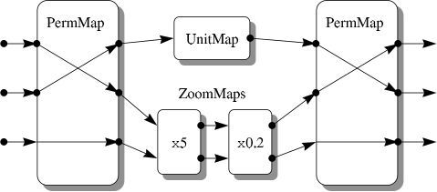

# Compound Mappings (CmpMaps)

We now turn to a rather special form of Mapping, the CmpMap.
The Mappings we have considered so far have been atomic, in the sense that they perform pre-defined elementary transformations.
A [`CmpMap`](crate::mappings::CmpMap), however, is a compound Mapping.
In essence, it is a framework for containing other Mappings and its purpose is to allow those Mappings to work together in various combinations while appearing as a single Object.
A CmpMap's behavior is therefore not pre-defined, but is determined by the other Mappings it contains.

## Combining Mappings in Series

Consider a simple example based on two 2-dimensional coordinate systems.
Suppose that to convert from one to the other we must swap the coordinate order and multiply both coordinates by 5, so that the coordinates (x₁,x₂) transform into (5x₂,5x₁).
This can be done in two stages:

1. Apply a PermMap ([Example — the PermMap](crate::guide::mappings#example--the-permmap)) to swap the coordinate order.
2. Apply a ZoomMap ([Transforming Coordinates](crate::guide::objects#transforming-coordinates)) to multiply both coordinate values by the constant 5.

The PermMap and ZoomMap are then said to operate *in series*, because they are applied sequentially (*c.f.* [Figure 2](crate::guide::concepts#compound-mappings)).
We can create a CmpMap that applies these Mappings in series as follows:

```rust
use starlink_ast::mappings::{CmpMap, Composition, PermMap, ZoomMap};

// Create the individual Mappings.
let inperm = [2, 1];
let outperm = [2, 1];
let permmap = PermMap::new(&inperm, &outperm, &[])?;
let zoommap = ZoomMap::new(2, 5.0)?;

// Combine them in series.
let cmpmap = CmpMap::new(Box::new(permmap), Box::new(zoommap), Composition::Series)?;
# use starlink_ast::mappings::Mapping;
# assert_eq!(cmpmap.tran2(&[1.0], &[2.0], true)?, (vec![10.0], vec![5.0]));
# Ok::<(), starlink_ast::error::AstError>(())
```

Here, the third argument, [`Composition::Series`](crate::mappings::Composition::Series), of the constructor indicates "in series".
The same CmpMap may be made with `permmap.then(Box::new(zoommap))`.

When used to transform coordinates in the forward direction, the resulting CmpMap will apply the first component Mapping (the PermMap) and then the second one (the ZoomMap).
When transforming in the inverse direction, it will apply the second one (in the inverse direction) and then the first one (also in the inverse direction).
In general, although not in this particular example, the order in which the two component Mappings are supplied is significant.
Clearly, also, the Nout attribute (number of output coordinates) for the first Mapping must equal the Nin attribute (number of input coordinates) for the second one.

## Combining Mappings in Parallel

Connecting two Mappings in series ([Combining Mappings in Series](#combining-mappings-in-series)) is not the only way of combining them.
The alternative, *in parallel*, involves applying the two Mappings at once but on different subsets of the coordinate values.

Consider, for example, a set of 3-dimensional coordinates and suppose we wish to transform them by swapping the first two coordinate values and multiplying the final one by 5, so that (x₁,x₂,x₃) transforms into (x₂,x₁,5x₃).
Again, we can perform each of these steps individually using Mappings similar to the PermMap and ZoomMap used earlier.
In this case, however, the ZoomMap is 1-dimensional and the individual Mappings are applied in parallel (*c.f.* [Figure 3](crate::guide::concepts#compound-mappings)).

Creating a CmpMap for this purpose is also very simple:

```rust
# use starlink_ast::mappings::{CmpMap, Composition, Mapping, PermMap, ZoomMap};
# use starlink_ast::coords::PointSet;
# let permmap = PermMap::new(&[2, 1], &[2, 1], &[])?;
# let zoommap = ZoomMap::new(1, 5.0)?;
let cmpmap = CmpMap::new(Box::new(permmap), Box::new(zoommap), Composition::Parallel)?;
# let out = cmpmap.transform(&PointSet::from_rows([[1.0, 2.0, 3.0]]), true)?;
# assert_eq!(&*out.point(0), [2.0, 1.0, 15.0]);
# Ok::<(), starlink_ast::error::AstError>(())
```

The only difference is that the third argument is now [`Composition::Parallel`](crate::mappings::Composition::Parallel), meaning "in parallel".
The same CmpMap may be made with `permmap.alongside(Box::new(zoommap))`.

As before, the order in which the two component Mappings are supplied is significant.
The first one acts on the lower-numbered input coordinate values (however many it needs) and produces the lower-numbered output coordinates, while the second Mapping acts on the higher-numbered input coordinates (however many remain) and generates the remaining higher-numbered output coordinates.
When the CmpMap transforms coordinates in the inverse direction, both component Mappings are applied to the same coordinates, but in the inverse direction.

Note that the Nin and Nout attributes of the component Mappings (*i.e.* the numbers of input and output coordinates) will sum to give the Nin and Nout attributes of the overall CmpMap.

## The Component Mappings

A CmpMap takes ownership of its component Mappings: they are moved into it when it is created.
To keep a component for other use, pass a copy of it made with `clone` ([Copying Objects](crate::guide::objects#copying-objects)).
Changes made afterwards to the copy you kept, including inverting it, do not affect the CmpMap.
This means that you may invert either component Mapping before inserting it into a CmpMap and need not worry about what happens to your own copy later.

The components of a CmpMap can be examined with [`decompose`](crate::mappings::CmpMap::decompose).

## Creating More Complex Mappings

Because a CmpMap is itself a Mapping, any existing CmpMap can substitute ([The Object Hierarchy](crate::guide::objects#the-object-hierarchy)) as a component Mapping when constructing a new CmpMap.
This has the effect of nesting one CmpMap inside another and opens up many new possibilities.
For example, combining three Mappings in series can be accomplished as follows:

```rust
use starlink_ast::mappings::{CmpMap, Composition, ZoomMap};

# let (map1, map2, map3) = (ZoomMap::new(1, 2.0)?, ZoomMap::new(1, 3.0)?, ZoomMap::new(1, 4.0)?);
let inner = CmpMap::new(Box::new(map2), Box::new(map3), Composition::Series)?;
let cmpmap = CmpMap::new(Box::new(map1), Box::new(inner), Composition::Series)?;
# use starlink_ast::mappings::Mapping;
# assert_eq!(cmpmap.tran1(&[1.0], true)?, vec![24.0]);
# Ok::<(), starlink_ast::error::AstError>(())
```

The way in which the individual component Mappings are grouped within the nested CmpMaps is not usually important.

A similar technique can be used to combine multiple Mappings in parallel and, of course, mixed series and parallel combinations are also possible ([Figure 4](crate::guide::concepts#compound-mappings)).
There is no built-in limit to how many CmpMaps may be nested in this way, so this mechanism provides an indefinitely extensible method of building complex Mappings out of the elemental building blocks provided by AST.

In practice, you might not need to construct such complex CmpMaps yourself very frequently, but they will often be returned by AST methods.
Nested CmpMaps underlie the library's entire ability to represent a wide range of different coordinate transformations.

## Example — Transforming Between Two Calibrated Images

Consider, as a practical example of CmpMaps, two images of the sky.
Suppose that for each image we have a Mapping which converts from pixel coordinates to a standard celestial coordinate system, say FK5 (J2000.0).
If we wish to inter-compare these images, we can do so by using this celestial coordinate system to align them.
That is, we first convert from pixel coordinates in the first image into FK5 coordinates and we then convert from FK5 coordinates into pixel coordinates in the second image.

If `mapa` and `mapb` are our two original Mappings, we could form a CmpMap which transforms directly between the pixel coordinates of the first and second images by combining these Mappings, as follows:

```rust
use starlink_ast::mappings::{CmpMap, Composition, Mapping};
# use starlink_ast::mappings::ShiftMap;
# let mapa = ShiftMap::new([10.0, 20.0]);
# let mapb = ShiftMap::new([12.0, 19.0]);

let mut inverse_b = mapb.clone();
inverse_b.invert();
let alignmap = CmpMap::new(Box::new(mapa), Box::new(inverse_b), Composition::Series)?;
# assert_eq!(alignmap.tran2(&[1.0], &[1.0], true)?, (vec![-1.0], vec![2.0]));
# Ok::<(), starlink_ast::error::AstError>(())
```

Here, we have used [`invert`](crate::mappings::Mapping::invert) ([Inverting Mappings](crate::guide::mappings#inverting-mappings)) to invert a copy of `mapb` before inserting it into the CmpMap because, as supplied, it converted in the wrong direction.
The original `mapb` is left as it was.

The forward transformation of the resulting CmpMap will now transform from pixel coordinates in the first image to pixel coordinates in the second image, while its inverse transformation will convert in the opposite direction.

## Over-Complex Compound Mappings

While a CmpMap provides a very flexible way of constructing arbitrarily complex Mappings ([Creating More Complex Mappings](#creating-more-complex-mappings)), it unfortunately also provides an opportunity for representing simple Mappings in complex ways.
Sometimes, unnecessary complexity can be difficult to avoid but can obscure important simplifications.

Consider the example above ([Example — Transforming Between Two Calibrated Images](#example--transforming-between-two-calibrated-images)), in which we inter-related two images of the sky *via* a CmpMap.
If the two images turned out to be simply offset from each other by a shift along each pixel axis, then this approach would align them correctly, but it would be inefficient.
This is because it would introduce unnecessary and expensive transformations to and from an intermediate celestial coordinate system, whereas a simple shift of pixel origin would suffice.

Recognizing that a simpler and more efficient solution exists obviously requires a little more than simply joining two Mappings end-to-end.
We must also determine whether the resulting CmpMap is more complex than it needs to be, *i.e.* contains redundant information.
If it is, we then need a way to simplify it.

The problem is not always just one of efficiency, however.
Sometimes we may also need to know something about the actual form a Mapping takes — *i.e.* the nature of the operations it performs.
Unnecessary complexity can obscure this, but such complexity can easily accumulate during normal data processing.

For example, a Mapping that transforms pixel coordinates into positions on the sky might be repeatedly modified as changes are made to the shape and size of the image.
Typically, on each occasion, another Mapping will be concatenated to reflect what has happened to the image.
This could soon make it difficult to discern the overall nature of the transformation from the complex CmpMap that accumulates.
If only shifts of origin were involved on each occasion, however, they could be combined into a single shift which could be represented much more simply.

Suppose we now wanted to represent our image's celestial coordinate calibration using FITS conventions ([Using Foreign FITS Encodings](crate::guide::foreign_fits)).
This requires AST to determine whether the Mapping which relates pixel coordinate to sky positions conforms to the FITS model (for example, whether it is equivalent to applying a single set of shifts and scale factors followed by a map projection).
Clearly, there is an important use here for some means of simplifying the internal structure of a CmpMap.

## Simplifying Compound Mappings

The ability to simplify compound Mappings is provided by the [`simplify`](crate::mappings::Mapping#method.simplify) method.
This method encapsulates a number of heuristics for converting Mappings, or combinations of Mappings within a CmpMap, into simpler, equivalent ones.
When applied to a CmpMap, `simplify` tries to reduce the number of individual Mappings within it by merging neighboring component Mappings together.
It will do this with both series and parallel combinations of Mappings, or both, and will handle CmpMaps nested to any depth ([Creating More Complex Mappings](#creating-more-complex-mappings)).

To illustrate how `simplify` works, consider the combination of Mappings shown in Figure 8.



*Figure 8: An over-complex compound Mapping, consisting of PermMaps, ZoomMaps and a UnitMap, which can be simplified to become a single UnitMap.
The enclosing nested CmpMaps have been omitted for clarity.*

If this were contained in a CmpMap, it could be simplified as follows:

```rust
# use starlink_ast::mappings::{CmpMap, Composition::*, DynMapping, Mapping, PermMap, UnitMap, ZoomMap};
# let swap = PermMap::new(&[2, 3, 1], &[3, 1, 2], &[])?;
# let unswap = PermMap::new(&[3, 1, 2], &[2, 3, 1], &[])?;
# let zooms = CmpMap::new(Box::new(ZoomMap::new(2, 5.0)?), Box::new(ZoomMap::new(2, 0.2)?), Series)?;
# let middle = CmpMap::new(Box::new(UnitMap::new(1)), Box::new(zooms), Parallel)?;
# let cmpmap = CmpMap::new(Box::new(swap), Box::new(middle), Series)?;
# let cmpmap: DynMapping = Box::new(CmpMap::new(Box::new(cmpmap), Box::new(unswap), Series)?);
let simpler = cmpmap.simplify()?;
# assert!(simpler.as_any().is::<UnitMap>());
# assert_eq!(simpler.nin(), 3);
# Ok::<(), starlink_ast::error::AstError>(())
```

In this case, the result would be a simple 3-dimensional UnitMap (the identity Mapping).
To reach this conclusion, `simplify` will have made a number of deductions, roughly as follows:

1. The two 2-dimensional ZoomMaps in series are equivalent to a single ZoomMap with a combined Zoom factor of unity.
   This, in turn, is equivalent to a 2-dimensional UnitMap.
2. This UnitMap in parallel with the other 1-dimensional UnitMap is equivalent to a single 3-dimensional UnitMap.
   This UnitMap, sandwiched between any other pair of Mappings, can then be eliminated.
3. The remaining two PermMaps in series are equivalent to a single 3-dimensional PermMap.
   When these are combined, the resulting PermMap is found to be equivalent to a 3-dimensional UnitMap.

This example is a little contrived, but illustrates how `simplify` can deal with even quite complicated compound Mappings through a series of incremental simplifications.
Where possible, this will result in either a simpler compound Mapping or, if feasible, an atomic (non-compound) Mapping, as here.
If no simplification is possible, `simplify` will just return a copy of the original Mapping.

Although `simplify` cannot identify every simplification that is theoretically possible, sufficient rules are included to deal with the most common and important cases.
