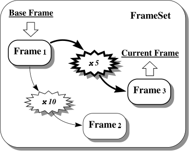

# Coordinate System Networks (FrameSets)

We saw in [An Introduction to Coordinate System Conversions](crate::guide::conversions) how [`convert_to`](crate::frames::FrameSearch::convert_to) could be used to find a Mapping that inter-relates a pair of coordinate systems represented by Frames.
There is a limitation to this, however, in that it can only be applied to coordinate systems that are inter-related by suitable conventions.
In the case of celestial coordinates, the relevant conventions are standards set out by the International Astronomical Union, and others, that define what these coordinate systems mean.
In practice, however, the relationships between many other coordinate systems are also of practical importance.

Consider, for example, the focal plane of a telescope upon which an image of the sky is falling.
We could measure positions in this focal plane in millimeters or, if there were a detector system such as a CCD present, we could count pixels.
We could also use celestial coordinates of many different kinds.
All of these systems are equivalent in their effectiveness at specifying positions in the focal plane, but some are more convenient than others for particular purposes.

Although we could, in principle, convert between all of these focal plane coordinate systems, there is no pre-defined convention for doing so.
This is because the conversions required depend on where the telescope is pointing and how the CCD is mounted in the focal plane.
Clearly, knowledge about this cannot be built into the AST library and must be supplied in some other way.
Note that this is exactly the same problem as we met in [The Domain Attribute](crate::guide::frames#the-domain-attribute) when discussing the Domain attribute — *i.e.* coordinate systems that apply to different physical domains require that extra information be supplied before we can convert between them.

What we need, therefore, is a general way to describe how coordinate systems are inter-related, so that when there is no convention already in place, we can define our own.
We can then look forward to converting, say, from pixels into galactic coordinates and *vice versa*.
In AST, the [`FrameSet`](crate::frames::FrameSet) class provides this capability.

## The FrameSet Model

Consider a coordinate system (call it number 1) which is represented by a Frame of some kind.
Now consider a Mapping which, when applied to the coordinates in system 1 yields coordinates in another system, number 2.
The Mapping therefore inter-relates coordinate systems 1 and 2.

Now consider a second Mapping which inter-relates system 1 and a further coordinate system, number 3.
If we wanted to convert coordinates between systems 2 and 3, we could do so by:

1. Applying our first Mapping in reverse, so as to convert between systems 2 and 1.
2. Applying the second Mapping, as given, to convert between systems 1 and 3.

We are not limited to three coordinate systems, of course.
In fact, we could continue to introduce any number of further coordinate systems, so long as we have a suitable Mapping for each one which relates it to one of the Frames already present.
Continuing in this way, we can build up a network in which Frames are inter-related by Mappings in such a way that there is always a way of converting between any pair of coordinate systems.

The FrameSet ([Figure 7](crate::guide::concepts#networks-of-coordinate-systems)) encapsulates these ideas.
It is a network composed of Frames and associated Mappings, in which there is always exactly one path, *via* Mappings, between any pair of Frames.
Since we assemble FrameSets ourselves, they can be used to represent any coordinate systems we choose and to set up the particular relationships between them that we want.

## Creating a FrameSet

Before we can create a FrameSet, we must have a Frame of some kind to put into it, so let's create a simple one:

```rust
use starlink_ast::frames::BasicFrameBuilder;

let frame1 = BasicFrameBuilder::new(2).domain("A").build()?;
# Ok::<(), starlink_ast::error::AstError>(())
```

We have set this Frame's Domain attribute ([The Domain Attribute](crate::guide::frames#the-domain-attribute)) to A so that it will be distinct from the others we will be using.
We can now create a new FrameSet containing just this Frame, as follows:

```rust
use starlink_ast::frames::FrameSet;
# use starlink_ast::frames::BasicFrameBuilder;
# let frame1 = BasicFrameBuilder::new(2).domain("A").build()?;

let mut frameset = FrameSet::new(Box::new(frame1));
# Ok::<(), starlink_ast::error::AstError>(())
```

So far, however, this Frame isn't related to any others.

## Adding New Frames to a FrameSet

We can now add further Frames to the FrameSet created above ([Creating a FrameSet](#creating-a-frameset)).
To do so, we must supply a new Frame and an associated Mapping that relates it to any of the Frames that are already present (there is only one present so far).
To keep the example simple, we will just use a ZoomMap that multiplies coordinates by 10.
The required Objects are created as follows:

```rust
use starlink_ast::frames::BasicFrameBuilder;
use starlink_ast::mappings::ZoomMap;

let frame2 = BasicFrameBuilder::new(2).domain("B").build()?;
let mapping12 = ZoomMap::new(2, 10.0)?;
# Ok::<(), starlink_ast::error::AstError>(())
```

To add the new Frame into our FrameSet, we use [`add_frame`](crate::frames::FrameSet::add_frame):

```rust
use starlink_ast::frames::FrameRef;
# use starlink_ast::frames::{BasicFrameBuilder, FrameSet};
# use starlink_ast::mappings::ZoomMap;
# let mut frameset = FrameSet::new(Box::new(BasicFrameBuilder::new(2).domain("A").build()?));
# let frame2 = BasicFrameBuilder::new(2).domain("B").build()?;
# let mapping12 = ZoomMap::new(2, 10.0)?;

frameset.add_frame(FrameRef::Index(1), Box::new(mapping12), Box::new(frame2))?;
# Ok::<(), starlink_ast::error::AstError>(())
```

Whenever a Frame is added to a FrameSet, it is assigned an integer index.
This index starts with 1 for the initial Frame used to create the FrameSet ([Creating a FrameSet](#creating-a-frameset)) and increments by one every time a new Frame is added.
This index is the primary way of identifying the Frames within a FrameSet, and is given as a [`FrameRef::Index`](crate::frames::FrameRef::Index).

When a Frame is added, we also have to specify which of the existing ones the new Frame is related to.
Here, we chose number 1, the only one present so far, and the new one we added became number 2.

Note that the FrameSet takes ownership of the Frames and Mappings that you insert into it.
If you want to keep using a Frame or Mapping after adding it, add a copy of it made with `clone` ([Copying Objects](crate::guide::objects#copying-objects)).
The FrameSet's contents are then independent of the copy you kept, so changing that copy afterwards has no effect on the FrameSet:

```rust
use starlink_ast::frames::{BasicFrameBuilder, Frame, FrameRef, FrameSet};
use starlink_ast::mappings::ZoomMap;

let mut frameset = FrameSet::new(Box::new(BasicFrameBuilder::new(2).domain("A").build()?));
let mut frame2 = BasicFrameBuilder::new(2).domain("B").build()?;
frameset.add_frame(FrameRef::Index(1), Box::new(ZoomMap::new(2, 10.0)?), Box::new(frame2.clone()))?;

// Changing our own copy does not change the Frame inside the FrameSet.
frame2.set_title("Focal plane");
assert_eq!(frameset.frame(FrameRef::Index(2))?.title()?, "2-d coordinate system");
# Ok::<(), starlink_ast::error::AstError>(())
```

We could also add a third Frame into our FrameSet, this time defining a coordinate system which is reached by multiplying the original coordinates (of `frame1`) by 5:

```rust
# use starlink_ast::frames::{BasicFrameBuilder, FrameRef, FrameSet};
# use starlink_ast::mappings::ZoomMap;
# let mut frameset = FrameSet::new(Box::new(BasicFrameBuilder::new(2).domain("A").build()?));
# frameset.add_frame(FrameRef::Index(1), Box::new(ZoomMap::new(2, 10.0)?), Box::new(BasicFrameBuilder::new(2).domain("B").build()?))?;
frameset.add_frame(
    FrameRef::Index(1),
    Box::new(ZoomMap::new(2, 5.0)?),
    Box::new(BasicFrameBuilder::new(2).domain("C").build()?),
)?;
# assert_eq!(frameset.nframe(), 3);
# Ok::<(), starlink_ast::error::AstError>(())
```

Our example FrameSet now contains three Frames and two Mappings with the arrangement shown in Figure 12.



*Figure 12: An example FrameSet, in which Frames 2 and 3 are related to Frame 1 by multiplying its coordinates by factors of 10 and 5 respectively.
The FrameSet's Base attribute has the value 1 and its Current attribute has the value 3.
The transformation performed when the FrameSet is used as a Mapping (*i.e.* from its base to its current Frame) is shown in bold.*

The total number of Frames is given by its read-only Nframe attribute, [`nframe`](crate::frames::FrameSet::nframe).

## The Base and Current Frames

At all times, one of the Frames in a FrameSet is designated to be its *base* Frame and one to be its *current* Frame (Figure 12).
These Frames are identified by two integer FrameSet attributes, Base and Current, which hold the indices of the nominated Frames within the FrameSet ([`base_index`](crate::frames::FrameSet::base_index) and [`current_index`](crate::frames::FrameSet::current_index)).

The existence of the base and current Frames reflects an important application of FrameSets, which is to attach coordinate systems to entities such as data arrays, data files, plotting surfaces (for graphics), *etc.*
In this context, the base Frame represents the "native" coordinate system of the attached entity — for example, the pixel coordinates of an image or the intrinsic coordinates of a plotting surface.
The other Frames within the FrameSet represent alternative coordinate systems which may also be used to refer to positions within that entity.
The current Frame represents the particular coordinate system which is currently selected for use.
For instance, if an image were being displayed, you would aim to label it with coordinates corresponding to the current Frame.
In order to see a different coordinate system, a software user would arrange for a different Frame to be made current.

The choice of base and current Frames may be changed at any time, simply by assigning new values to the FrameSet's Base and Current attributes.
For example, to make the Frame with index 3 become the current Frame, you could use:

```rust
# use starlink_ast::frames::{BasicFrameBuilder, FrameRef, FrameSet};
# use starlink_ast::mappings::UnitMap;
# let mut frameset = FrameSet::new(Box::new(BasicFrameBuilder::new(2).build()?));
# frameset.add_frame(FrameRef::Index(1), Box::new(UnitMap::new(2)), Box::new(BasicFrameBuilder::new(2).build()?))?;
# frameset.add_frame(FrameRef::Index(1), Box::new(UnitMap::new(2)), Box::new(BasicFrameBuilder::new(2).build()?))?;
frameset.set_current(FrameRef::Index(3))?;
# Ok::<(), starlink_ast::error::AstError>(())
```

You can nominate the same Frame to be both the base and current Frame if you wish.

By default (*i.e.* if the Base or Current attribute is un-set), the first Frame added to a FrameSet becomes its base Frame and the last one added becomes its current Frame (although this is reversed if the FrameSet's Invert attribute is set).
Whenever a new Frame is added to a FrameSet, the Current attribute is modified so that the new Frame becomes the current one.
This behavior is reflected in the state of the example FrameSet in Figure 12.

## Referring to the Base and Current Frames

It is often necessary to refer to the base and current Frames ([The Base and Current Frames](#the-base-and-current-frames)) within a FrameSet, but it can be cumbersome having to obtain their indices from the Base and Current attributes on each occasion.
To make this easier, [`FrameRef::Base`](crate::frames::FrameRef::Base) and [`FrameRef::Current`](crate::frames::FrameRef::Current) may be used to refer to the base and current Frames respectively.
They may be used whenever a Frame index is required.

For example, when adding a new Frame to a FrameSet ([Adding New Frames to a FrameSet](#adding-new-frames-to-a-frameset)), you could use the following to indicate that the new Frame is related to the existing current Frame, whatever its index happens to be:

```rust
# use starlink_ast::frames::{BasicFrameBuilder, FrameRef, FrameSet};
# use starlink_ast::mappings::UnitMap;
# let mut frameset = FrameSet::new(Box::new(BasicFrameBuilder::new(2).build()?));
# let (mapping, frame) = (UnitMap::new(2), BasicFrameBuilder::new(2).build()?);
frameset.add_frame(FrameRef::Current, Box::new(mapping), Box::new(frame))?;
# Ok::<(), starlink_ast::error::AstError>(())
```

Of course, the Frame you added would then become the new current Frame.

## Using a FrameSet as a Mapping

A FrameSet is both a [`Frame`](crate::frames::Frame) and a [`Mapping`](crate::mappings::Mapping).
Its behavior when used as a Mapping is particularly important.

Consider, for instance, using a FrameSet with a coordinate transformation method such as [`tran2`](crate::mappings::Mapping::tran2):

```rust
use starlink_ast::mappings::Mapping;
# use starlink_ast::frames::{BasicFrameBuilder, FrameRef, FrameSet};
# use starlink_ast::mappings::ZoomMap;
# let mut frameset = FrameSet::new(Box::new(BasicFrameBuilder::new(2).domain("A").build()?));
# frameset.add_frame(FrameRef::Index(1), Box::new(ZoomMap::new(2, 10.0)?), Box::new(BasicFrameBuilder::new(2).domain("B").build()?))?;
# frameset.add_frame(FrameRef::Index(1), Box::new(ZoomMap::new(2, 5.0)?), Box::new(BasicFrameBuilder::new(2).domain("C").build()?))?;
# let (xin, yin) = ([1.0, 2.0], [3.0, 4.0]);

let (xout, yout) = frameset.tran2(&xin, &yin, true)?;
# assert_eq!((xout, yout), (vec![5.0, 10.0], vec![15.0, 20.0]));
# Ok::<(), starlink_ast::error::AstError>(())
```

The coordinate transformation applied by this FrameSet would be the one which converts between its base and current Frames.
Using the FrameSet in Figure 12, for example, the coordinates would be multiplied by a factor of 5.
If we instead requested the FrameSet's inverse transformation, we would be transforming from its current Frame to its base Frame, so our example FrameSet would then multiply by a factor of 0.2.

Whenever the choice of base and current Frames changes, the transformations which a FrameSet performs when used as a Mapping also change to reflect this.
The Nin and Nout attributes may also change in consequence, because they are determined by the numbers of axes in the FrameSet's base and current Frames respectively.
These numbers need not necessarily be equal, of course.

Like any Mapping, a FrameSet may also be inverted by changing the boolean sense of its Invert attribute, *e.g.* using [`invert`](crate::mappings::Mapping::invert) ([Inverting Mappings](crate::guide::mappings#inverting-mappings)).
If this happens, the values of the FrameSet's Base and Current attributes are interchanged, along with its Nin and Nout attributes, so that its base and current Frames swap places.
When used as a Mapping, the FrameSet will therefore perform the inverse transformation to that which it performed previously.

To summarize, a FrameSet may be used exactly like any other Mapping which inter-relates the coordinate systems described by its base and current Frames.

## Extracting a Mapping from a FrameSet

Although it is very convenient to use a FrameSet when a Mapping is required ([Using a FrameSet as a Mapping](#using-a-frameset-as-a-mapping)), a FrameSet necessarily contains additional information and sometimes this might cause inefficiency or confusion.
For example, if you wanted to use a Mapping contained in one FrameSet and insert it into another, it would probably not be efficient to insert the whole of the first FrameSet into the second one, although it would work.

In such a situation, [`mapping`](crate::frames::FrameSet::mapping) allows you to extract a Mapping from a FrameSet.
You do this by specifying the two Frames which the Mapping should inter-relate.
For example:

```rust
# use starlink_ast::frames::{BasicFrameBuilder, FrameRef, FrameSet};
# use starlink_ast::mappings::{Mapping, ZoomMap};
# let mut frameset = FrameSet::new(Box::new(BasicFrameBuilder::new(2).domain("A").build()?));
# frameset.add_frame(FrameRef::Index(1), Box::new(ZoomMap::new(2, 10.0)?), Box::new(BasicFrameBuilder::new(2).domain("B").build()?))?;
# frameset.add_frame(FrameRef::Index(1), Box::new(ZoomMap::new(2, 5.0)?), Box::new(BasicFrameBuilder::new(2).domain("C").build()?))?;
let map = frameset.mapping(FrameRef::Index(2), FrameRef::Index(3))?;
# assert_eq!(map.tran2(&[10.0], &[20.0], true)?, (vec![5.0], vec![10.0]));
# Ok::<(), starlink_ast::error::AstError>(())
```

would return a Mapping that converted between Frames 2 and 3 in the FrameSet.
Its inverse transformation would then convert in the opposite direction, *i.e.* between Frames 3 and 2.
The Mapping is independent of the FrameSet, which is not changed.

Very often, the Mapping returned by `mapping` will be a compound Mapping, or CmpMap ([Compound Mappings](crate::guide::cmpmaps)).
This reflects the fact that conversion between the two Frames may need to be done *via* an intermediate coordinate system so that several stages may be involved.
You can, however, easily simplify this Mapping (where this is possible) by using [`simplify`](crate::mappings::Mapping#method.simplify) ([Simplifying Compound Mappings](crate::guide::cmpmaps#simplifying-compound-mappings)) and this is recommended if you plan to use it for transforming a large amount of data.

## Using a FrameSet as a Frame

A FrameSet can also be used as a Frame, in which capacity it almost always behaves as if its current Frame had been used instead.
For example, if you request the Title attribute of a FrameSet using:

```rust
use starlink_ast::frames::Frame;
# use starlink_ast::frames::{BasicFrameBuilder, FrameSet};
# let frameset = FrameSet::new(Box::new(BasicFrameBuilder::new(2).title("Pixels").build()?));

let title = frameset.title()?;
# assert_eq!(title, "Pixels");
# Ok::<(), starlink_ast::error::AstError>(())
```

the result will be the Title of the current Frame, or a suitable default if the current Frame's Title attribute is un-set.
The same also applies to other attribute operations — *i.e.* setting, clearing and testing attributes.
Most attributes shared by both Frames and FrameSets behave in this way, such as Naxes, Label(axis), Format(axis), *etc.*
There are, however, a few exceptions:

- **Class**:
  Is "FrameSet".
- **ID** and **Ident**:
  Identify the particular FrameSet (not its current Frame).
- **Nin**:
  Equals the number of axes in the FrameSet's base Frame.
- **Invert**:
  Is independent of any of the Objects within the FrameSet.

The attributes a particular class of Frame adds, such as a SkyFrame's Equinox, are read from the current Frame itself, through [`current`](crate::frames::FrameSet::current), and the set of them changes when a Frame of another class is made current.
Changing an attribute of the current Frame is described in [Maintaining the Integrity of FrameSets](crate::guide::frameset_ops#maintaining-the-integrity-of-framesets).

## Extracting a Frame from a FrameSet

Although a FrameSet may be used in place of its current Frame in most situations, it is sometimes convenient to have direct access to a specified Frame within it.
This may be obtained using [`frame`](crate::frames::FrameSet::frame), as follows:

```rust
use starlink_ast::frames::FrameRef;
# use starlink_ast::frames::{BasicFrameBuilder, FrameSet};
# let frameset = FrameSet::new(Box::new(BasicFrameBuilder::new(2).build()?));

let frame = frameset.frame(FrameRef::Base)?;
# use starlink_ast::frames::BasicFrame;
# let copy: BasicFrame = frame.as_any().downcast_ref::<BasicFrame>().unwrap().clone();
# Ok::<(), starlink_ast::error::AstError>(())
```

This would return a reference to the base Frame within the FrameSet.
Note the use of [`FrameRef::Base`](crate::frames::FrameRef::Base) ([Referring to the Base and Current Frames](#referring-to-the-base-and-current-frames)) as shorthand for the base Frame's index.
To keep a copy of a Frame of a known class, downcast it with `as_any` and `clone` the result.

## Removing a Frame from a FrameSet

Removing a Frame from a FrameSet is straightforward and is performed using [`remove_frame`](crate::frames::FrameSet::remove_frame).
You identify the Frame you wish to remove in the usual way.
For example, the following would remove the Frame with index 1:

```rust
# use starlink_ast::frames::{BasicFrameBuilder, FrameRef, FrameSet};
# use starlink_ast::mappings::{Mapping, ZoomMap};
# let mut frameset = FrameSet::new(Box::new(BasicFrameBuilder::new(2).domain("A").build()?));
# frameset.add_frame(FrameRef::Index(1), Box::new(ZoomMap::new(2, 10.0)?), Box::new(BasicFrameBuilder::new(2).domain("B").build()?))?;
# frameset.add_frame(FrameRef::Index(1), Box::new(ZoomMap::new(2, 5.0)?), Box::new(BasicFrameBuilder::new(2).domain("C").build()?))?;
frameset.remove_frame(FrameRef::Index(1))?;
# assert_eq!(frameset.nframe(), 2);
# assert_eq!(frameset.tran2(&[10.0], &[10.0], true)?, (vec![5.0], vec![5.0]));
# Ok::<(), starlink_ast::error::AstError>(())
```

The only restriction is that you cannot remove the last remaining Frame because a FrameSet must always contain at least one Frame.
When a Frame is removed, the Frames which follow it are re-numbered (*i.e.* their indices are reduced by one) so as to preserve the sequence of consecutive Frame indices.
The FrameSet's Nframe attribute is also decremented.

If appropriate, `remove_frame` will modify the FrameSet's Base and/or Current attributes so that they continue to identify the same Frames as previously.
If either the base or current Frame is removed, however, the corresponding attribute will become un-set, so that it reverts to its default value ([The Base and Current Frames](#the-base-and-current-frames)) and therefore identifies an alternative Frame.

Note that it is quite permissible to remove any Frame from a FrameSet, even although other Frames may appear to depend on it.
For example, in Figure 12, if Frame 1 were removed, the correct relationship between Frames 2 and 3 would still be preserved, although they would be re-numbered as Frames 1 and 2.
